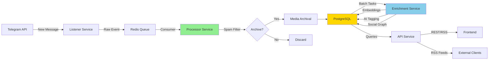

# Architecture Overview

The OSINT Intelligence Platform is a production-ready system for archiving, enriching, and analyzing Telegram channels with multi-model AI enrichment, semantic search, and configurable intelligence rules.

!!! info "Architecture Overview"
    **Design**: Containerized microservices with Docker Compose
    **Layers**: Core infrastructure, Application services, Monitoring stack, Authentication (optional)
    **Philosophy**: Self-hosted, cost-effective, privacy-first

---

## System Overview

The platform operates as a distributed pipeline that continuously monitors Telegram channels, processes messages through real-time and batch enrichment stages, and serves intelligence via REST APIs and dynamic RSS feeds.

### Core Capabilities

- **Real-time Ingestion**: Monitor hundreds of Telegram channels simultaneously with automatic spam filtering (>95% accuracy)
- **AI-Powered Enrichment**: Multi-model LLM classification (6 models), entity extraction, semantic embeddings
- **Content-Addressed Storage**: SHA-256 deduplication for media files, 50-70% storage savings
- **Semantic Search**: pgvector embeddings for similarity queries across all archived content
- **Dynamic Distribution**: Subscribe to any search query combination via RSS feeds
- **Self-Hosted Infrastructure**: Zero cloud dependencies, self-hosted LLM and translation APIs

---

## Data Flow Architecture

The platform follows a strict separation between **real-time critical path** (Processor) and **background batch processing** (Enrichment):



### Flow Stages

1. **Ingestion** (Listener): Monitors Telegram folders, pushes raw messages to Redis
2. **Real-time Processing** (Processor): Spam filter → routing → entity extraction → media download → persistence
3. **Batch Enrichment** (Enrichment): Embeddings → AI tagging → social graph → translation backfill
4. **API Layer**: REST endpoints, GraphQL, dynamic RSS feeds
5. **Distribution**: Next.js frontend, RSS readers, N8N automation

---

## Service Responsibilities

### Critical Path vs Background Tasks

This separation is **fundamental** to the platform architecture:

| Service | Mode | Speed Requirement | Purpose | Failure Impact |
|---------|------|-------------------|---------|----------------|
| **Processor** | Real-time, per-message | <1s critical path | Spam filter, routing, quick entity extraction, media archival | Messages don't flow through pipeline |
| **Enrichment** | Background batch | Hours acceptable | Embeddings, deep LLM analysis, social graph | Messages stored but temporarily less searchable |

!!! warning "Critical Architectural Constraint"
    **NEVER** add expensive operations (embeddings, multi-step LLM calls, API rate-limited tasks) to the Processor. These belong in Enrichment workers. Processor handles 10-50 messages/second; blocking operations cascade into Redis queue backlog.

### Services

The canonical list of services, profiles and ports is [Docker Services](../reference/docker-services.md); it is not repeated here. The roles that matter for the design:

- **listener** monitors Telegram and publishes to Redis Streams; it owns the Telegram session.
- **processor-worker** is the real-time path: embedding spam filter, LLM classification, translation, persistence. **media-worker** downloads media in the background when the media lane is on, and **media-sync** moves archived files to long-term storage.
- **backlog-worker** (profile `llm-gateway`) re-classifies pending and spam-flagged messages on the gateway batch lane.
- **enrichment-*** workers run background tasks (embeddings, routing, geolocation, clustering, validation); **enrichment-fact-check** audits LLM classifications.
- **api** and **frontend** serve the data; **rss-ingestor**, **opensanctions** and **entity-ingestion** feed correlation and the entity graph.
- **postgres**, **redis**, **minio** are the stores; the LLM is an external GPU gateway or the local **ollama** (which also serves search embeddings).
- **monitoring** profile: Prometheus, Grafana, Alertmanager, Loki, Promtail, exporters, ntfy.


---

## Key Architectural Decisions

### 1. Processor vs Enrichment Separation

**Decision**: Split message processing into real-time (Processor) and batch (Enrichment) stages.

**Rationale**:
- Processor handles 10-50 messages/second during active monitoring
- Expensive operations (embeddings: 100ms, LLM tagging: 3-25s, translation API: 200ms) would create backlog
- Enrichment can catch up during quiet hours without blocking ingestion

**Implementation**:
```python
# Processor (services/processor/src/main.py)
# Real-time critical path (<1s per message):
- Embedding spam filter (fast, CPU; obvious spam skips the LLM)
- Channel routing (archive_all vs selective_archive)
- Regex entity extraction (compiled patterns)
- Media download + SHA-256 deduplication
- LLM classification (spam, relevance, topic, importance, archive decision) via the LLM gateway or Ollama
- PostgreSQL persistence

# Enrichment (services/enrichment/src/workers/)
# Background batch processing (hours acceptable):
- Embedding generation (sentence-transformers)
- AI tagging with reasoning (optional; CPU-era Ollama endpoint)
- Translation backfill (DeepL API)
- Social graph extraction (forward chains)
- Engagement polling (views, reactions)
- Comment scraping from discussion groups
```

**Trade-offs**:
- ✅ **Pro**: Processor never blocks, channels scale linearly
- ✅ **Pro**: Can scale Enrichment independently (add more workers)
- ⚠️ **Con**: Temporary delay before embeddings/tags appear (acceptable for historical archive)

### 2. Content-Addressed Media Storage

**Decision**: Use SHA-256 hashing for all media files with MinIO S3-compatible storage.

**Rationale**:
- Telegram channels frequently repost same media (propaganda, infographics, maps)
- 30-40% deduplication savings observed in production
- Spam filter prevents 80-90% of media downloads (cost optimization)

**Implementation**:
```sql
-- Database schema (infrastructure/postgres/init.sql)
CREATE TABLE media_files (
    id SERIAL PRIMARY KEY,
    sha256_hash CHAR(64) UNIQUE NOT NULL,
    file_type VARCHAR(20),
    file_size BIGINT,
    mime_type VARCHAR(100),
    s3_key VARCHAR(500),  -- media/{hash[:2]}/{hash[2:4]}/{hash}.{ext}
    reference_count INTEGER DEFAULT 0
);

CREATE TABLE message_media (
    message_id INTEGER REFERENCES messages(id),
    media_file_id INTEGER REFERENCES media_files(id),
    media_group_id BIGINT,  -- Telegram album grouping
    position INTEGER DEFAULT 0
);
```

**Storage Path Pattern**:
```
media/
  ab/
    cd/
      abcdef1234567890...hash.jpg  (SHA-256 content hash)
```

**Trade-offs**:
- ✅ **Pro**: 30-40% storage savings (~€50/month at scale)
- ✅ **Pro**: Integrity verification via hash
- ✅ **Pro**: Automatic deduplication across all channels
- ⚠️ **Con**: Need reference counting for garbage collection
- ⚠️ **Con**: Can't delete media until all messages referencing it are deleted

### 3. Folder-Based Channel Management

**Decision**: Use Telegram's native folder feature instead of configuration files or admin panels.

**Rationale**:
- Traditional approach requires SSH + config editing + service restart
- Telegram folders sync across devices (mobile, desktop, web)
- Real-time discovery via Telegram API polling (5-minute detection)

**Implementation**:
```python
# services/listener/src/channel_discovery.py
async def discover_channels_from_folders(telegram_client):
    """
    Discovers channels from Telegram folders matching patterns:
    - Archive-* → archive_all rule (store everything)
    - Monitor-* → selective_archive rule (high importance only)
    - Discover-* → auto-joined channels (14-day probation)
    """
    folders = await telegram_client.get_folders()

    for folder in folders:
        if folder.title.startswith("Archive-"):
            rule = "archive_all"
        elif folder.title.startswith("Monitor-"):
            rule = "selective_archive"
        elif folder.title.startswith("Discover-"):
            rule = "discovery"
        else:
            continue  # Ignore other folders

        # Sync channels in this folder to database
        await sync_folder_channels(folder, rule)
```

**User Workflow** (30 seconds):
1. Open Telegram app (mobile or desktop)
2. Find channel to monitor
3. Drag to folder: `Archive-UA`, `Monitor-RU`, or auto-joined `Discover-*`
4. Platform detects change within 5 minutes
5. Messages start flowing immediately

**Trade-offs**:
- ✅ **Pro**: Zero technical knowledge required
- ✅ **Pro**: Works from any device (mobile, desktop)
- ✅ **Pro**: No service restart needed
- ⚠️ **Con**: Requires Telegram API credentials
- ⚠️ **Con**: Folder naming convention must be documented

### 4. Schema-First Database with SQL Migrations

**Decision**: `init.sql` is the source of truth for fresh installs; numbered SQL migrations in `infrastructure/postgres/migrations/` carry existing installs forward (`scripts/migrate.sh`). No Alembic.

**Rationale**:
- PostgreSQL's `docker-entrypoint-initdb.d` only runs on **fresh** databases
- Plain SQL files are easy to review, run in place and preserve production data
- Migrations that touch the large `messages` table are written to avoid blocking writes (`CONCURRENTLY`, lock timeouts)

**Workflow**: change `init.sql`, add a migration, update the ORM models. See [Database Migrations](database-migrations.md) and the operator view in [Upgrades](../operator-guide/upgrades.md).

### 5. LLM Lanes for Workload Isolation

**Decision**: Isolate LLM work by *lane* (realtime, audit, batch), each with its own API key and model alias on an OpenAI-compatible gateway, instead of one shared queue.

**Rationale**:
- The processor needs low-latency classification on the critical path
- Fact-check (reasoning model) and backlog/RSS-validation work are slow and must not starve it
- The gateway caps parallelism per key and schedules by alias priority, so a busy batch lane cannot block realtime calls

The CPU-era alternative was two Ollama instances (`ollama` and `ollama-batch`); that option remains with `LLM_PROVIDER=ollama` but is not used in production.

Details: [LLM_GATEWAY.md](https://github.com/osintukraine/osint-intelligence-platform/blob/master/docs/architecture/LLM_GATEWAY.md) and [LLM Gateway and Providers](../operator-guide/external-llm.md).

### 6. Graph Data on PostgreSQL + pgvector

**Decision**: Build every graph from PostgreSQL (tables, nightly materialized views) and pgvector similarity, in
the API, per request. No separate graph database.

**How each graph is built** (`services/api/src/routers`):

| Graph (where it is shown) | Built from | Endpoint |
|---|---|---|
| Message entity network (message page → Network → Entities) | `message_tags` (classifier / AI tagging: keywords, entities, places), `message_entities` → `curated_entities`, OpenSanctions matches, related posts by pgvector similarity | `GET /api/messages/{id}/network` |
| Social graph per message (Network → Social) | `messages`, `message_replies`, `message_comments`, `message_reactions`, `channel_interactions` | `GET /api/social-graph/messages/{id}` |
| Channel network | pgvector cosine similarity between channels' message embeddings | `GET /api/channels/{id}/network` |
| Channel influence | materialized view `channel_influence_network` | `GET /api/social-graph/influence-network` |
| Virality | materialized view `top_forwarded_messages` | `GET /api/social-graph/virality/top-forwarded` |
| Entity relationships (entity page) | Wikidata SPARQL + OpenSanctions properties, cached 7 days on the entity row | `GET /api/entities/{source}/{id}/relationships` |

The analytics service refreshes the materialized views nightly at 03:00 UTC (`message_social_graph`,
`channel_influence_network`, `top_influencers`, `top_forwarded_messages`, `unified_message_entities`).
`message_social_graph` is refreshed but not yet read by any endpoint. There is no `entity_cooccurrence` table, and
the graphs use no recursive CTEs and no NetworkX: they are one- or two-hop queries.

**State of the data (production, 2026-10-25)**: message tags 772k; comments 409k; reactions 53.8M;
`message_social_graph` 662k rows; forwards 1.6k and channel interactions 505 (their producers were restored on
2026-10-24 after the May–September gap, so they grow daily); curated entity matches cover ~1% of posts;
`entity_relationships` 5 rows.

**Rationale**:
- The queries are shallow (one or two hops, per message, channel or entity) and small (hundreds to low thousands
  of edges), next to a relational archive of millions of messages
- Similarity edges come from pgvector next to the data; a separate graph store would have to copy and sync them
- The limit today is data coverage (entity matching, relationships, forward history), not the query engine

**When to revisit**: a dedicated graph engine (e.g. FalkorDB, Neo4j) earns its place only for multi-hop work at
scale — path finding between channels, community detection over the whole forward network — and only once a
concrete query is too slow in PostgreSQL. Until then, improve coverage of the existing schema.

---

## Technology Stack

### Backend Services

| Category | Technology | Purpose | Why Chosen |
|----------|-----------|---------|------------|
| **API Framework** | FastAPI 0.104+ | REST endpoints, OpenAPI docs | Async support, type hints, auto-validation |
| **Database** | PostgreSQL 16 | Primary data store | JSONB, full-text search, pgvector extension |
| **Vector Store** | pgvector | Semantic similarity search | Native PostgreSQL integration, no separate service |
| **Message Queue** | Redis 7 Streams | Event streaming, task queues | Persistent ordered queues, consumer groups |
| **Object Storage** | MinIO | Media file storage | S3-compatible, self-hosted, no cloud dependency |
| **ORM** | SQLAlchemy 2.0 | Database access | Async support, mature ecosystem |
| **Telegram Client** | Telethon | Telegram API client | Stable, well-documented, async |
| **Python** | 3.11+ | Application runtime | Modern async/await, type hints |

### Frontend

| Technology | Purpose | Why Chosen |
|-----------|---------|------------|
| **Next.js 15** | React framework | Server-side rendering, file-based routing |
| **React 19** | UI library | Component reusability, large ecosystem |
| **TailwindCSS** | Styling | Utility-first, rapid development |
| **AG Grid Community** | Data tables | High-performance virtual scrolling (1M+ rows) |
| **Recharts** | Charts/graphs | Simple API, responsive |
| **Sigma.js + graphology** | Network visualizations | WebGL rendering of entity, channel and social graphs; ForceAtlas2 layout (replaced Cytoscape.js in January 2026) |
| **ReactFlow** | News timeline | Node/edge layout of articles and correlated posts |
| **Jotai** | State management | Lightweight, atomic state |
| **React Query** | Data fetching | Caching, background refetch |

### AI/ML Stack

| Component | Technology | Purpose | Cost |
|-----------|-----------|---------|------|
| **LLM Inference** | OpenAI-compatible gateway (LiteLLM in front of vLLM on a GPU host), or Ollama | Classification, fact-check, validation | Self-hosted |
| **Embeddings** | sentence-transformers, models pinned in `infrastructure/models/models.txt` and mounted read-only | Spam filter and similarity (the multilingual MiniLM model for spam) | €0/month |
| **Search embeddings** | Ollama `all-minilm` (384d vectors) in pgvector | Semantic search | €0/month |
| **Translation** | DeepL Pro Free API | English translation (500k chars/month free) | €0/month |
| **Language Detection** | fasttext / langdetect | Detect message language | €0/month |

Models are selected by gateway alias or `OLLAMA_MODEL`; classifier prompts are versioned rows in `llm_prompts` (see [LLM Integration](llm-integration.md)).

### DevOps & Infrastructure

| Component | Technology | Purpose |
|-----------|-----------|---------|
| **Containerization** | Docker Compose | Service orchestration |
| **Reverse Proxy** | Caddy | Auto HTTPS, reverse proxy |
| **Monitoring** | Prometheus + Grafana | Metrics, dashboards |
| **Logging** | Loki + Grafana | Centralized log aggregation |
| **Notifications** | ntfy | Push notifications (self-hosted) |
| **Database Admin** | NocoDB | Airtable-like database UI |
| **Authentication** | Ory Kratos + Oathkeeper | IAM, access proxy |

---

## Repository Structure

```
osint-intelligence-platform/
├── services/                    # Application services (microservices architecture)
│   ├── listener/               # Telegram channel monitoring
│   ├── processor/              # Real-time message processing
│   ├── enrichment/             # Background batch enrichment
│   ├── api/                    # REST API + GraphQL endpoints
│   ├── frontend-nextjs/        # Next.js web application
│   ├── rss-ingestor/           # RSS feed ingestion
│   ├── opensanctions/          # OpenSanctions entity matching
│   ├── entity-ingestion/       # CSV entity import
│   ├── notifier/               # Notification routing
│   ├── analytics/              # Social graph analytics
│   └── migration/              # Legacy data migration
│
├── shared/python/              # Shared Python modules
│   ├── models/                 # SQLAlchemy ORM models
│   ├── config/                 # Configuration management
│   ├── database/               # Database utilities
│   ├── ai/                     # AI/LLM utilities
│   ├── observability/          # Logging + metrics
│   ├── telegram/               # Telegram utilities
│   ├── translation/            # Translation services
│   └── notifications/          # Notification client
│
├── infrastructure/             # Infrastructure configuration
│   ├── postgres/
│   │   └── init.sql            # Database schema (4,658 lines)
│   ├── docker/
│   │   └── Dockerfile.pytorch-cpu  # Shared base image
│   ├── prometheus/
│   ├── grafana/
│   ├── ollama/
│   └── caddy/
│
├── scripts/                    # Operational scripts
│   ├── stack-manager.sh        # Interactive Docker menu
│   ├── telegram_auth.py        # Telegram session authentication
│   └── build-pytorch-services.sh
│
├── docs/                       # Documentation
├── data/                       # Persistent data
├── config/                     # Application configuration
├── telegram_sessions/          # Telegram session files
├── docker-compose.yml          # Primary compose file
├── .env                        # Environment variables
└── CLAUDE.md                   # AI assistant instructions
```

---

## Performance Characteristics

### Throughput Benchmarks

| Stage | Throughput | Latency | Bottleneck |
|-------|------------|---------|------------|
| **Listener** | 50-100 msg/s | <50ms | Telegram API rate limits |
| **Processor** | 10-20 msg/s | 300-500ms | LLM classification |
| **Enrichment** | 2-5 msg/s | 3-25s | AI tagging (deep LLM reasoning) |
| **API Search** | 100-500 req/s | 50-200ms | PostgreSQL full-text search |
| **Semantic Search** | 20-50 req/s | 100-300ms | pgvector HNSW index scan |

### Resource Usage (Production)

| Service | CPU | Memory | Disk I/O |
|---------|-----|--------|----------|
| **Processor (×2)** | 0.5-1.5 cores | 512MB | Low |
| **Ollama (if used)** | CPU inference is bursty and the heaviest consumer | model dependent | Low |
| **PostgreSQL** | 1-2 cores | 2-4GB | High (writes) |
| **Redis** | 0.1-0.3 cores | 512MB | Low |
| **MinIO** | 0.1-0.5 cores | 256MB | High (reads/writes) |
| **Frontend** | 0.1-0.2 cores | 256MB | Low |
| **Enrichment (12 workers)** | 1-3 cores | 1-2GB | Medium |

**Total**: 8-16 cores, 12-24GB RAM, 100GB+ disk (+ media storage)

---

## Deployment Patterns

### Development Environment

```bash
# Start core services + dev tools
docker-compose --profile dev --profile monitoring up -d
```

### Production Environment

```bash
# Start production + monitoring + enrichment
docker-compose \
  --profile monitoring \
  --profile enrichment \
  -f docker-compose.yml \
  -f docker-compose.production.yml \
  up -d
```

### Scaling Strategies

```bash
# Scale processor workers (handle message spikes)
docker-compose up -d --scale processor-worker=4

# Add enrichment workers (catch up on backlog)
docker-compose --profile enrichment up -d --scale enrichment-fast-pool=2
```

---

## Related Documentation

- [Service Reference](services/index.md) - Detailed documentation for each service
- [Data Models](database-schema.md) - SQLAlchemy model reference
- [Shared Libraries](shared-libraries.md) - Shared Python module documentation
- [Installation Guide](../operator-guide/installation.md) - Production deployment checklist

---

!!! success "Documentation Complete"
    This architecture overview was generated from the actual codebase on 2025-12-09.
