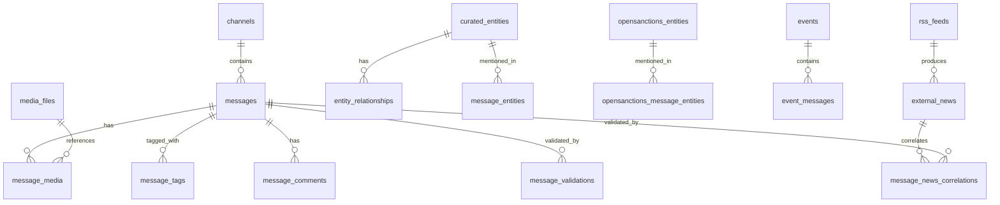

# Database Schema

Complete reference for the PostgreSQL database schema.

---

## Overview

The database schema is defined in `infrastructure/postgres/init.sql` (about 7,200 lines) which serves as the source of truth for fresh installs; numbered SQL migrations in `infrastructure/postgres/migrations/` carry existing databases forward.

**Key Facts:**
- **60+ tables** and 6 materialized views defined in `init.sql`
- **PostgreSQL 16** required, with the **pgvector** and **PostGIS** extensions (custom image `infrastructure/docker/postgres-pgvector-postgis.Dockerfile`)
- **No Alembic** (archived): plain SQL migrations applied by `scripts/migrate.sh`

**Extensions Used:**
```sql
CREATE EXTENSION IF NOT EXISTS pg_trgm;           -- Similarity search
CREATE EXTENSION IF NOT EXISTS btree_gin;         -- Compound GIN indexes
CREATE EXTENSION IF NOT EXISTS vector;            -- pgvector for embeddings
CREATE EXTENSION IF NOT EXISTS pg_stat_statements; -- Query performance
CREATE EXTENSION IF NOT EXISTS postgis;           -- Spatial queries (map)
```

---

## Schema Management

### Source of Truth

`infrastructure/postgres/init.sql` defines everything for a fresh install:
- All table definitions
- Indexes and constraints
- Functions and triggers
- Seed data (prompts, slang glossary)

### Schema Changes

Every change goes into `init.sql` **and** a numbered migration. See [Database Migrations](database-migrations.md) for the full workflow.

```bash
# Test schema changes with clean rebuild (development only: wipes data)
docker-compose down
docker volume rm osint-intelligence-platform_postgres_data
docker-compose up -d postgres
./scripts/migrate.sh --baseline
```

---

## Core Tables

### messages

Primary message storage with AI enrichment (about 85 columns; the excerpt below shows the groups, see `init.sql` for the full definition):

```sql
CREATE TABLE IF NOT EXISTS messages (
    id BIGSERIAL PRIMARY KEY,
    message_id BIGINT NOT NULL,
    channel_id INTEGER NOT NULL REFERENCES channels(id) ON DELETE CASCADE,

    -- Content
    content TEXT,
    telegram_date TIMESTAMP WITH TIME ZONE,

    -- Social graph metadata
    author_user_id BIGINT,
    replied_to_message_id BIGINT,
    forward_from_channel_id BIGINT,
    forward_from_message_id BIGINT,
    forward_date TIMESTAMP WITH TIME ZONE,

    -- Comments/Discussion
    has_comments BOOLEAN DEFAULT FALSE,
    comments_count INTEGER DEFAULT 0,
    linked_chat_id BIGINT,
    comments_fetched_at TIMESTAMP WITH TIME ZONE,
    comments_refreshed_at TIMESTAMP WITH TIME ZONE,

    -- Engagement
    views INTEGER,
    forwards INTEGER,

    -- Translation
    language_detected VARCHAR(10),
    content_translated TEXT,
    translation_provider VARCHAR(50),

    -- Media
    media_type VARCHAR(20),       -- photo, video, document
    grouped_id BIGINT,            -- Album grouping
    media_status VARCHAR(20),     -- media lane queue: pending, downloading, archived, failed, unavailable, expired
    media_attempts SMALLINT NOT NULL DEFAULT 0,
    album_message_ids BIGINT[],

    -- AI Enrichment: Spam
    is_spam BOOLEAN DEFAULT FALSE,
    spam_confidence NUMERIC(5, 2),
    spam_type VARCHAR(50),        -- financial, promotional, off_topic
    spam_review_status VARCHAR(20),

    -- AI Enrichment: Classification (LLM; osint_topic = 'pending' until classified)
    osint_topic VARCHAR(100),     -- combat, equipment, casualties, ... general, pending
    importance_level VARCHAR(20), -- high, medium, low
    admin_topic_override VARCHAR(50),       -- NULL = use the AI value
    admin_importance_override VARCHAR(20),

    -- AI Enrichment: derived metadata (written by the classifier, prompt v13)
    content_sentiment VARCHAR(20),
    content_urgency_level INTEGER,
    content_complexity VARCHAR(20),
    key_phrases TEXT[],

    -- AI Enrichment: Embeddings
    content_embedding vector(384), -- all-MiniLM-L6-v2
    embedding_model VARCHAR(100),

    -- Full-text search
    search_vector TSVECTOR,

    -- Deduplication
    content_hash VARCHAR(64),     -- SHA-256
    duplicate_of_message_id BIGINT REFERENCES messages(id) ON DELETE SET NULL,
    duplicate_reason VARCHAR(50), -- phash_match, text_embedding, cross_check, sha256_match

    -- Moderation (admin_* by a person, is_hidden by automation such as fact-check)
    deleted_at TIMESTAMP WITH TIME ZONE,
    admin_hidden BOOLEAN DEFAULT FALSE,
    is_hidden BOOLEAN DEFAULT FALSE,
    hidden_reason TEXT,

    -- Timestamps
    created_at TIMESTAMP WITH TIME ZONE DEFAULT NOW(),
    updated_at TIMESTAMP WITH TIME ZONE DEFAULT NOW(),

    CONSTRAINT uq_messages_channel_message UNIQUE (channel_id, message_id)
);
```

**Key Indexes:**
```sql
CREATE INDEX idx_messages_channel_date ON messages(channel_id, telegram_date DESC, id DESC);
CREATE INDEX idx_messages_content_embedding ON messages USING hnsw (content_embedding vector_cosine_ops)
  WITH (m = 16, ef_construction = 64);
CREATE INDEX idx_messages_search_vector ON messages USING GIN (search_vector);
CREATE INDEX idx_messages_osint_topic ON messages(osint_topic);
CREATE INDEX idx_messages_importance_level ON messages(importance_level);
CREATE INDEX idx_messages_is_spam ON messages(is_spam);
-- Partial indexes for the work queues (migrations 038, 051, 058)
CREATE INDEX idx_messages_topic_pending ON messages(id) WHERE osint_topic = 'pending';
CREATE INDEX idx_messages_pending_embedding ON messages(id) WHERE content_embedding IS NULL AND is_spam = false;
```

---

### channels

Telegram channel metadata with folder-based rules:

```sql
CREATE TABLE IF NOT EXISTS channels (
    id SERIAL PRIMARY KEY,
    telegram_id BIGINT UNIQUE NOT NULL,
    username VARCHAR(100),
    access_hash BIGINT,

    -- Identity
    name VARCHAR(255),
    description TEXT,
    type VARCHAR(20) NOT NULL DEFAULT 'source',  -- 'source', 'filtered', 'archive'

    -- Trust signals
    verified BOOLEAN DEFAULT FALSE,
    scam BOOLEAN DEFAULT FALSE,
    fake BOOLEAN DEFAULT FALSE,
    restricted BOOLEAN DEFAULT FALSE,

    -- Categorization (human-managed)
    source_type VARCHAR(30),      -- state_media, military_unit, journalist, osint_aggregator, ... unknown
    affiliation VARCHAR(20),      -- russia, ukraine, neutral, unknown

    -- Folder-based management
    folder VARCHAR(100),          -- Telegram folder name (e.g. Archive-UA)
    rule VARCHAR(50),             -- archive_all, selective_archive, ...
    source_account VARCHAR(50) DEFAULT 'default',  -- which Telegram account monitors it

    -- Status
    active BOOLEAN DEFAULT TRUE,
    removed_at TIMESTAMP WITH TIME ZONE,

    -- Backfill tracking
    backfill_status VARCHAR(20),  -- pending, in_progress, completed, failed
    backfill_from_date TIMESTAMP WITH TIME ZONE,
    backfill_messages_fetched INTEGER DEFAULT 0,
    backfill_completed_at TIMESTAMP WITH TIME ZONE,

    -- Discovery and retention
    discovery_status VARCHAR(50), -- discovered, evaluating, promoted, rejected
    discovery_metadata JSONB DEFAULT '{}'::jsonb,
    quality_metrics JSONB,
    retention_policy VARCHAR(50) DEFAULT 'permanent',

    -- Timestamps
    created_at TIMESTAMP WITH TIME ZONE DEFAULT NOW(),
    updated_at TIMESTAMP WITH TIME ZONE DEFAULT NOW(),
    last_message_at TIMESTAMP WITH TIME ZONE
);
```

---

### curated_entities

Curated entity reference data (equipment, units, people, places) imported by the entity-ingestion service:

```sql
CREATE TABLE IF NOT EXISTS curated_entities (
    id BIGSERIAL PRIMARY KEY,
    entity_type VARCHAR(50) NOT NULL,       -- CHECK: equipment, individual, organization, location,
                                            -- event, military_unit, ship, aircraft, military_vehicle,
                                            -- military_weapon, electronic_warfare, component
    name TEXT NOT NULL,
    aliases TEXT[],
    description TEXT,
    latitude FLOAT, longitude FLOAT,        -- for locations

    source_reference TEXT NOT NULL,         -- provenance: 'armyguide', 'odin_sanctions', ...
    metadata JSONB NOT NULL DEFAULT '{}'::jsonb,
    notes TEXT,
    content_hash VARCHAR(64) UNIQUE NOT NULL,  -- SHA-256 deduplication

    embedding vector(384),                  -- semantic matching
    embedding_model VARCHAR(100),
    search_vector tsvector GENERATED ALWAYS AS (...) STORED,

    created_at TIMESTAMP DEFAULT NOW(),
    updated_at TIMESTAMP DEFAULT NOW()
);
```

---

### opensanctions_entities

Sanctions data from OpenSanctions/Yente:

```sql
CREATE TABLE IF NOT EXISTS opensanctions_entities (
    id SERIAL PRIMARY KEY,
    opensanctions_id VARCHAR(255) UNIQUE NOT NULL,  -- e.g. "ofac-13661"
    external_id VARCHAR(255),

    entity_type VARCHAR(50) NOT NULL,       -- Person, Organization, Vessel, Aircraft
    schema_type VARCHAR(50) NOT NULL,       -- OpenSanctions schema
    name VARCHAR(500) NOT NULL,
    aliases TEXT[],
    description TEXT,
    properties JSONB,                       -- birth_date, nationalities, positions, ...

    risk_classification VARCHAR(20) NOT NULL,  -- sanctioned, pep, criminal, corporate
    datasets TEXT[] NOT NULL,               -- ['us_ofac_sdn', 'eu_fsf']
    topics TEXT[],                          -- ['sanction', 'role.pep']
    sanctions_reason TEXT,

    entity_embedding vector(384),           -- HNSW-indexed
    embedding_model VARCHAR(100),

    first_seen TIMESTAMP WITH TIME ZONE NOT NULL DEFAULT NOW(),
    last_seen TIMESTAMP WITH TIME ZONE NOT NULL DEFAULT NOW(),
    mention_count INTEGER NOT NULL DEFAULT 1,
    data_updated_at TIMESTAMP WITH TIME ZONE NOT NULL DEFAULT NOW(),
    created_at TIMESTAMP WITH TIME ZONE NOT NULL DEFAULT NOW(),
    updated_at TIMESTAMP WITH TIME ZONE NOT NULL DEFAULT NOW()
);
```

---

### llm_prompts

Versioned LLM prompts for classification. Insert a new version and flip `is_active`; never edit a row in place (see [LLM Integration](llm-integration.md)):

```sql
CREATE TABLE IF NOT EXISTS llm_prompts (
    id SERIAL PRIMARY KEY,
    task VARCHAR(50) NOT NULL,              -- 'message_classification', 'classify_screen', ...
    name VARCHAR(100) NOT NULL,
    prompt_type VARCHAR(20) NOT NULL,       -- 'system' or 'user_template'
    content TEXT NOT NULL,

    -- Versioning
    version INTEGER NOT NULL DEFAULT 1,
    is_active BOOLEAN NOT NULL DEFAULT TRUE,

    -- Model selection
    model_name VARCHAR(100),                -- per-prompt override; NULL = global default
    model_parameters JSONB DEFAULT '{}',    -- {"temperature": 0.3}
    task_category VARCHAR(50),              -- 'processor', 'enrichment'

    -- Metadata
    description TEXT,
    variables TEXT[],
    expected_output_format TEXT,

    -- Performance tracking
    usage_count INTEGER DEFAULT 0,
    error_count INTEGER DEFAULT 0,
    success_count INTEGER DEFAULT 0,
    failure_count INTEGER DEFAULT 0,
    avg_latency_ms NUMERIC(10,2),

    -- A/B testing and progressive rollout
    rollout_percentage INTEGER DEFAULT 100,

    -- Timestamps
    created_at TIMESTAMP WITH TIME ZONE DEFAULT NOW(),
    updated_at TIMESTAMP WITH TIME ZONE,

    CONSTRAINT uq_prompt_task_version UNIQUE (task, version)
);
```

---

### events

Event timeline entries built from correlated RSS articles and Telegram posts:

```sql
CREATE TABLE IF NOT EXISTS events (
    id BIGSERIAL PRIMARY KEY,
    title TEXT NOT NULL,
    summary TEXT,                          -- LLM-generated
    event_type VARCHAR(50) NOT NULL,       -- strike, advance, retreat, political, humanitarian, ...

    location_name TEXT,
    location_coords POINT,

    event_date DATE,
    first_seen_at TIMESTAMP WITH TIME ZONE NOT NULL DEFAULT NOW(),
    last_activity_at TIMESTAMP WITH TIME ZONE NOT NULL DEFAULT NOW(),

    -- breaking -> developing -> confirmed -> verified
    tier_status VARCHAR(20) NOT NULL DEFAULT 'breaking',
    is_major BOOLEAN NOT NULL DEFAULT FALSE,   -- pinned, never auto-archived
    archived_at TIMESTAMP WITH TIME ZONE,      -- NULL = active

    rss_source_count INTEGER NOT NULL DEFAULT 0,
    telegram_channel_count INTEGER NOT NULL DEFAULT 0,
    telegram_message_count INTEGER NOT NULL DEFAULT 0,

    search_vector tsvector,
    deleted_at TIMESTAMP WITH TIME ZONE,       -- soft delete with audit trail
    created_at TIMESTAMP WITH TIME ZONE NOT NULL DEFAULT NOW(),
    updated_at TIMESTAMP WITH TIME ZONE NOT NULL DEFAULT NOW()
);
```

The "verified" tier requires two or more independent RSS sources or a human decision. Telegram-only clusters are tracked in `telegram_event_clusters`.

---

## Vector Storage

### Embedding Columns

The schema uses **pgvector** with 384-dimensional embeddings:

```sql
-- Messages (semantic search)
content_embedding vector(384)

-- Curated entities
embedding vector(384)

-- OpenSanctions entities
entity_embedding vector(384)

-- External news (cross-validation)
embedding vector(384)

-- Telegram event clusters
cluster_embedding vector(384)
```

### HNSW Indexes

High-performance approximate nearest neighbor search:

```sql
-- Message embeddings
CREATE INDEX idx_messages_content_embedding
ON messages USING hnsw (content_embedding vector_cosine_ops)
WITH (m = 16, ef_construction = 64);

-- Also HNSW: opensanctions_entities.entity_embedding (idx_opensanctions_entities_embedding),
-- telegram_event_clusters.cluster_embedding (idx_clusters_embedding)
```

### Similarity Search

```sql
-- Find similar messages
SELECT id, content,
       1 - (content_embedding <=> query_embedding) as similarity
FROM messages
WHERE content_embedding IS NOT NULL
ORDER BY content_embedding <=> query_embedding
LIMIT 10;
```

---

## Full-Text Search

### TSVECTOR Column

```sql
-- Auto-populated by trigger
search_vector TSVECTOR

-- GIN index for fast search
CREATE INDEX idx_messages_search_vector
ON messages USING GIN (search_vector);

-- Weights: original content = A, English translation = B
```

### Search Trigger

```sql
CREATE OR REPLACE FUNCTION messages_search_vector_update()
RETURNS TRIGGER AS $$
BEGIN
    NEW.search_vector :=
        setweight(to_tsvector('english', COALESCE(NEW.content, '')), 'A') ||
        setweight(to_tsvector('english', COALESCE(NEW.content_translated, '')), 'B');
    RETURN NEW;
END;
$$ LANGUAGE plpgsql;

CREATE TRIGGER messages_search_vector_trigger
    BEFORE INSERT OR UPDATE ON messages
    FOR EACH ROW EXECUTE FUNCTION messages_search_vector_update();
```

---

## Key Relationships



---

## Table Summary (60+ tables)

| Category | Tables |
|----------|--------|
| **Core** | users (legacy), channels, channel_submissions, messages, message_quarantine, telegram_accounts, shadow_account_state |
| **Media** | storage_boxes, media_files, message_media, duplicate_clusters |
| **Auth / access** | feed_tokens, feed_subscriptions, api_keys, export_jobs, user_roles |
| **AI/LLM** | llm_prompts, model_configuration, message_tags, tag_stats, message_reclassifications, classification_fact_checks, enrichment_llm_attempts, geolocation_llm_attempts, decision_log |
| **Entities** | curated_entities, opensanctions_entities, message_entities, opensanctions_message_entities, entity_relationships |
| **Events and maps** | events, event_messages, event_sources, event_config, telegram_event_clusters, cluster_messages, location_gazetteer, message_locations |
| **RSS** | rss_feeds, news_sources, external_news, message_validations, message_news_correlations |
| **Translation** | translation_config, translation_usage |
| **Config** | platform_config, folder_rules, military_slang |
| **Social graph** | telegram_users, message_comments, message_reactions, message_replies, message_forwards, channel_interactions, message_engagement_timeline, viral_posts |
| **User activity** | user_bookmarks, user_comments, admin_audit_log |
| **Operations** | schema_migrations, enrichment_progress, dr_backup_history, dr_failover_history |

Materialized views (refreshed nightly by the analytics service): `message_social_graph`, `channel_influence_network`, `top_influencers`, `unified_message_entities`, `top_forwarded_messages`, `analytics_daily_summary`.

The exhaustive per-table reference is [Database Tables](../reference/database-tables.md).

----------|--------|
| **Core** | users, channels, messages, message_quarantine |
| **Media** | media_files, message_media |
| **Auth** | feed_tokens, export_jobs |
| **AI/LLM** | llm_prompts, model_configuration, message_tags, tag_stats |
| **Entities** | curated_entities, opensanctions_entities, message_entities, opensanctions_message_entities, entity_relationships |
| **Events** | events, event_messages, event_sources, event_config |
| **RSS** | rss_feeds, news_sources, external_news, message_validations, message_news_correlations |
| **Translation** | translation_config, translation_usage |
| **Config** | platform_config, folder_rules, military_slang |
| **Audit** | decision_logs |
| **Comments** | message_comments, telegram_users |
| **User Activity** | user_roles, user_bookmarks, user_comments, admin_audit_log, api_keys |

---

## User Identity Pattern

!!! warning "Critical Pattern for User-Related Tables"
    All user-related tables use `kratos_identity_id` (UUID), NOT the legacy `users.id` (INTEGER).

### The Legacy `users` Table (DEPRECATED)

The `users` table was designed for local authentication with password hashing. **Do not use it for new features.**

```sql
-- ❌ LEGACY - Do not reference in new tables
CREATE TABLE users (
    id SERIAL PRIMARY KEY,           -- Integer ID
    username VARCHAR(50) UNIQUE,
    email VARCHAR(255) UNIQUE,
    hashed_password VARCHAR(255),    -- Local auth only
    ...
);
```

### The Correct Pattern: kratos_identity_id

All user-facing features must use `kratos_identity_id` (UUID) directly:

```sql
-- ✅ CORRECT - Use this pattern for new tables
CREATE TABLE my_user_feature (
    id SERIAL PRIMARY KEY,
    kratos_identity_id UUID NOT NULL,  -- Ory Kratos identity UUID
    ...
);

CREATE INDEX idx_my_feature_user ON my_user_feature(kratos_identity_id);
```

### Tables Using kratos_identity_id

| Table | Purpose |
|-------|---------|
| `user_roles` | Application roles per Kratos identity |
| `user_bookmarks` | User-saved messages |
| `user_comments` | User comments on messages |
| `admin_audit_log` | Admin action audit trail |
| `feed_tokens` | RSS/Atom feed authentication tokens |
| `api_keys` | Programmatic API access keys |

### Why This Matters

Ory Kratos manages user identities externally and uses 128-bit UUIDs. Converting UUIDs to integers causes PostgreSQL INTEGER overflow:

```
ERROR: value out of int32 range: 27537564199611862328462258318740097659
```

See [Authentication - Developer Guide](../security-guide/authentication.md#developer-guide-user-identity-in-database) for ORM and router patterns.

---

## Performance Considerations

### Index Strategy

1. **B-tree** for equality/range queries (channel_id, telegram_date)
2. **GIN** for full-text search (search_vector)
3. **HNSW** for vector similarity (embeddings)
4. **Partial indexes** for filtered queries (WHERE is_spam = false)

### Common Query Patterns

```sql
-- Recent messages by channel (uses idx_messages_channel_date)
SELECT * FROM messages
WHERE channel_id = $1
ORDER BY telegram_date DESC
LIMIT 50;

-- Semantic search (uses HNSW index)
SELECT id, 1 - (content_embedding <=> $1) as score
FROM messages
WHERE is_spam = false
ORDER BY content_embedding <=> $1
LIMIT 20;

-- Full-text search (uses GIN index)
SELECT * FROM messages
WHERE search_vector @@ plainto_tsquery('english', $1)
ORDER BY telegram_date DESC;
```

---

## Related Documentation

- [Database Migrations](database-migrations.md) - Schema change workflow
- [Shared Libraries](shared-libraries.md) - SQLAlchemy models
- [Environment Variables](../reference/environment-variables.md) - PostgreSQL config
