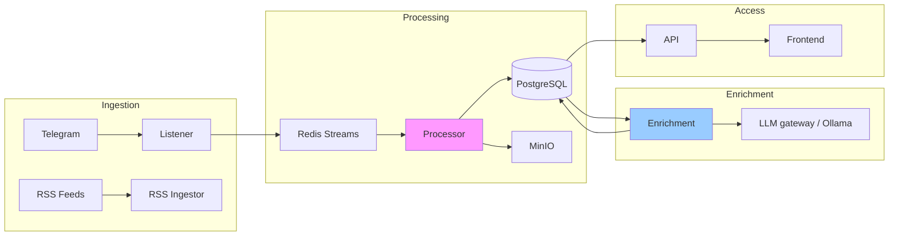

# Services Deep Dive

Detailed documentation of each microservice in the platform.

---

## Overview

The OSINT Intelligence Platform consists of **20+ application containers** (one image can back several compose services) organized by function. The canonical service, profile and port list is [Docker Services](../../reference/docker-services.md).

- **Core Pipeline**: Listener → Processor → Enrichment
- **Data Access**: API → Frontend
- **Supporting**: RSS Ingestor, OpenSanctions, Notifier
- **Infrastructure**: PostgreSQL, Redis, MinIO, LLM gateway or Ollama
- **Background workers**: media-worker, [media-sync](media-sync.md), backlog-worker



---

## Core Services

### [Listener Service](listener.md)

**Entry point for all Telegram data** - monitors channels, discovers from folders, pushes to Redis.

| Aspect | Details |
|--------|---------|
| **Function** | Telegram monitoring, channel discovery, backfill |
| **Tech** | Telethon, Redis Streams, asyncio |
| **Files** | `telegram_listener.py` (~950 lines), `channel_discovery.py` (~820 lines) |
| **Critical** | Owns Telegram session - never create clients elsewhere. One listener per account (`listener`, or `listener-russia` / `listener-ukraine` with the `multi-account` profile) |

[:octicons-arrow-right-24: Full Documentation](listener.md)

---

### [Processor Service](processor.md)

**Real-time message processing** - spam filtering, LLM classification, media archival.

| Aspect | Details |
|--------|---------|
| **Function** | Pipeline: embedding spam filter → LLM classification → routing → entities → media → DB |
| **Tech** | Redis consumer, LLM gateway or Ollama, embedding spam filter, MinIO, PostgreSQL |
| **Target** | <1s per message latency |
| **Files** | `message_processor.py` (~2,000 lines), `llm_classifier.py` (~1,750 lines) |

[:octicons-arrow-right-24: Full Documentation](processor.md)

---

### [Enrichment Service](enrichment.md)

**Background batch processing** - AI tagging, embeddings, entity matching, validation.

| Aspect | Details |
|--------|---------|
| **Function** | 38 task modules across 11 worker services plus a router |
| **Tech** | Coordinator + Router pattern, Redis Streams, LLM gateway / Ollama |
| **Speed** | Background - can be slow (hours OK) |
| **LLM Tasks** | Dedicated workers per task; fact-check and RSS validation use the gateway |

[:octicons-arrow-right-24: Full Documentation](enrichment.md)

---

### [Fact-Check Service](fact-check.md)

**Classification quality assurance** - validates LLM classifications, surfaces discrepancies.

| Aspect | Details |
|--------|---------|
| **Function** | Re-classifies sampled messages, compares with original; casts the auditor vote of the classification council |
| **Tech** | Stratified sampling, LLM gateway audit lane, confidence-based actions |
| **Actions** | Auto-hide off-topic, auto-reclassify `uncertain` originals, queue the rest for review |
| **Admin UI** | `/admin/fact-check` for human review |

[:octicons-arrow-right-24: Full Documentation](fact-check.md)

---

### [API Service](api.md)

**REST API** - FastAPI backend for all data access.

| Aspect | Details |
|--------|---------|
| **Function** | Search, messages, entities, channels, RSS feeds |
| **Tech** | FastAPI, SQLAlchemy async, Pydantic |
| **Auth** | Optional Ory Kratos integration |
| **Files** | 40+ router modules (`routers/`, `routers/admin/`) |

[:octicons-arrow-right-24: Full Documentation](api.md)

---

### [Frontend Service](frontend.md)

**Web UI** - Next.js application for search and exploration.

| Aspect | Details |
|--------|---------|
| **Function** | Search, message view, entity explorer, admin |
| **Tech** | Next.js 15, React 19, Tailwind CSS |
| **Rendering** | SSR for SEO, client components for interactivity |
| **API** | Uses `lib/api.ts` centralized client |

[:octicons-arrow-right-24: Full Documentation](frontend.md)

---

## Supporting Services

### [Notifier Service](notifier.md)

Event batching and notification publishing to external channels (Slack, webhooks).

[:octicons-arrow-right-24: Full Documentation](notifier.md)

---

### [RSS Ingestor Service](rss-ingestor.md)

Polls RSS feeds, extracts articles, generates embeddings for cross-validation.

[:octicons-arrow-right-24: Full Documentation](rss-ingestor.md)

---

### [OpenSanctions Service](opensanctions.md)

Entity matching against OpenSanctions database via Yente API.

[:octicons-arrow-right-24: Full Documentation](opensanctions.md)

---

### [Analytics Service](analytics.md)

Aggregate statistics and trend analysis.

[:octicons-arrow-right-24: Full Documentation](analytics.md)

---

### [Entity Ingestion Service](entity-ingestion.md)

Custom entity import from CSV/JSON sources.

[:octicons-arrow-right-24: Full Documentation](entity-ingestion.md)

---

### [Migration Service](migration.md)

Legacy data migration from tg-archive format.

[:octicons-arrow-right-24: Full Documentation](migration.md)

---

### [Translation Backfill Service](translation-backfill.md)

Batch translation of historical messages.

[:octicons-arrow-right-24: Full Documentation](translation-backfill.md)

---

### [Media Sync Service](media-sync.md)

Copies media from the local buffer to the Hetzner mount (or MinIO in legacy mode) and marks it synced.

[:octicons-arrow-right-24: Full Documentation](media-sync.md)

---

## Infrastructure Services

### PostgreSQL

Primary data store with pgvector for embeddings and full-text search.

- **Schema**: `infrastructure/postgres/init.sql` plus numbered migrations
- **Extensions**: pgvector, pg_trgm, btree_gin
- **Vector search**: HNSW indexes for cosine similarity

### Redis

Message queue and caching layer.

- **Streams**: `telegram:messages:realtime` and `telegram:messages:backfill` for Listener→Processor (legacy `telegram:messages` is only drained)
- **Streams**: `enrich:*` for Enrichment worker pools
- **Consumer groups**: Reliable delivery with acknowledgment

### MinIO

S3-compatible object storage for archived media.

- **Bucket**: `osint-media`
- **Paths**: Content-addressed `media/{hash[:2]}/{hash[2:4]}/{hash}.{ext}`
- **Deduplication**: SHA-256 prevents storing duplicates

### LLM

Production uses an OpenAI-compatible gateway on a GPU host (`LLM_PROVIDER=openai`) with three lanes (realtime, audit, batch). Local Ollama is the non-GPU option and also serves search-query embeddings.

- **Operator guide**: [LLM Gateway and Providers](../../operator-guide/external-llm.md)
- **Developer reference**: [LLM_GATEWAY.md](https://github.com/osintukraine/osint-intelligence-platform/blob/master/docs/architecture/LLM_GATEWAY.md)
- **Also**: [Backlog Re-classification](../../operator-guide/backlog-reclassification.md), [Media Lanes](../../operator-guide/media-lanes.md), [Embedding Models](../../operator-guide/model-provisioning.md)

---

## Service Communication

### Message Flow

```
Telegram → Listener → Redis Streams → Processor → PostgreSQL → Enrichment → PostgreSQL
                                          ↓
                          local buffer → media-sync → Hetzner mount / MinIO
```

### Communication Patterns

| Pattern | Used By | Purpose |
|---------|---------|---------|
| **Redis Streams** | Listener→Processor, Router→Workers | Async message passing |
| **Direct DB** | Enrichment tasks | Batch read/write |
| **HTTP API** | Frontend→API | Sync data access |
| **Pub/Sub** | Notifier | Event broadcast |

---

## Service Scaling

### Horizontal Scaling

```bash
# Scale processor workers (default 2: PROCESSOR_WORKER_REPLICAS)
docker-compose up -d --scale processor-worker=4

# Enrichment workers have fixed container names and host metrics ports; scale via ENRICHMENT_WORKER_REPLICAS in .env where compose supports it
```

### Resource Guidelines

| Service | CPU | Memory | Scaling |
|---------|-----|--------|---------|
| Listener | Low | 512MB | One per Telegram account |
| Processor | Medium | 1GB | 2-8 workers |
| Enrichment | High | 2GB | By worker type |
| API | Low | 512MB | 1-4 instances |
| Ollama (non-GPU option) | High | 8GB+ | Single (CPU inference) |

---

## Related Documentation

- [Architecture Overview](../architecture.md) - System design
- [Adding Features](../adding-features.md) - Extension patterns
- [Database Schema](../../reference/database-tables.md) - Table reference
