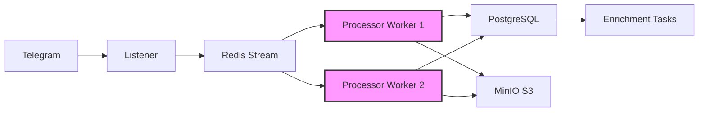
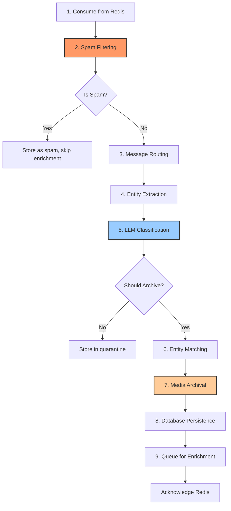

# Processor Service

> Real-time message processing on the critical path (<1s latency target)

## Overview

The **Processor Service** is the core intelligence engine of the OSINT platform. It consumes messages from Redis, applies the embedding spam filter, performs LLM-based classification, extracts entities, archives media, and persists structured intelligence to PostgreSQL.

!!! info "Critical Path Service"
    Processor is on the **critical path** of message flow. Failures here mean messages don't reach the database. The service is designed for high reliability with automatic retries, graceful degradation, and comprehensive error handling.

**Key Characteristics:**

- **Speed**: <1s processing time per message (target)
- **Position**: Between Listener (Telegram) and Enrichment (batch processing)
- **Role**: Real-time per-message classification and archival
- **Scaling**: Horizontally scalable (default: 2 `processor-worker` replicas, `PROCESSOR_WORKER_REPLICAS`)



## Architecture

### Key Files

| File | Size | Purpose |
|------|------|---------|
| `main.py` | - | Worker initialization and Redis consumer loop |
| `redis_consumer.py` | - | Consumer-group reader over the realtime, backfill and legacy streams; auto-claim, dead letter queue (`dead_letter_queue.py`) |
| `message_processor.py` | ~2,000 lines | Main orchestrator for the pipeline (with sub-steps) |
| `llm_classifier.py` | ~1,750 lines | Unified (and modular) LLM classification: spam + topic + importance + enrichment fields |
| `embedding_spam_filter.py` | - | Embedding spam / off-topic filter and LLM pre-filter |
| `media_archiver.py` | - | Content-addressed storage with SHA-256 deduplication |
| `media_lane.py`, `media_worker.py` | - | Optional background media download (`media-worker` service) |
| `entity_matcher.py` | - | Semantic entity matching against `curated_entities` |
| `entity_extractor.py` | - | Regex-based extraction (hashtags, mentions, coordinates) |
| `message_router.py` | - | Channel rule lookup and routing decisions |
| `backlog_worker.py`, `backlog_jobs_worker.py`, `backlog_reclassify.py` | - | Re-classification of the backlog (`backlog-worker`, `llm-gateway` profile) |
| `message_timeout.py`, `backpressure.py` | - | Per-message time limit; backpressure on the gateway lane |

The same image (`services/processor/Dockerfile`) runs several compose services: `processor-worker` (realtime), `processor-worker-backfill` (profile `backfill`), `media-worker`, `backlog-worker`, `backlog-enrich`, `backlog-reprocess`.

### Processing Pipeline

The processor executes **5 major stages** for each message, with sub-steps:

!!! note "Pipeline Architecture"
    The `message_processor.py` docstring describes 5 major stages. The detailed view below shows sub-steps (9 total) to clarify the decision flow; the exact order of translation and media inside the code differs slightly from the diagram.

**5 Major Stages** (from code):
1. **LLM Classification** - Spam detection + topic + importance + archive decision
2. **Entity Extraction** - Regex-based (hashtags, mentions, coordinates)
3. **Media Archival** - If has media and should_archive
4. **Translation** - If needed and enabled
5. **PostgreSQL Persistence** - Store structured intelligence

**Detailed Flow (9 sub-steps)**:



## Processing Stages

### 1. Consume from Redis

Messages arrive via Redis Streams from the Listener service. Each message contains:

- Message ID, channel ID, content
- Media metadata (type, URL, grouped_id for albums)
- Social graph data (author, replies, forwards, comments)
- Telegram timestamps and engagement metrics

### 2. Spam Filtering

Spam handling is layered, not a single call:

1. **Embedding filter** (`embedding_spam_filter.py`): a multilingual sentence-embedding model (loaded from `/models`, see [Embedding Models](../../operator-guide/model-provisioning.md)) scores similarity to spam and off-topic examples. At or above `EMBEDDING_SPAM_THRESHOLD` (0.75) a message counts as spam. The code default for `EMBEDDING_SPAM_MODEL` is `all-MiniLM-L6-v2`; `.env.example` points it at `/models/paraphrase-multilingual-MiniLM-L12-v2`.
2. **Pre-filter before the LLM**: with LLM classification on, spam similarity at or above the admin setting `llm_prefilter_spam_similarity` (code default 0.90; 1.0 disables the pre-filter) is decided without calling the LLM.
3. **LLM verdict**: spam types are crypto, gambling, scam, adult, advertising (including fundraising) and filler. A war report is never spam because of an attached ad or donation footer.
4. **Later re-checks**: the backlog worker re-judges spam-flagged messages and fact-check audits a sample.

Spam messages are stored with `is_spam=true` for review but skip the enrichment pipeline. Details: [LLM_GATEWAY.md](https://github.com/osintukraine/osint-intelligence-platform/blob/master/docs/architecture/LLM_GATEWAY.md).

### 3. Message Routing

Determines archiving strategy based on channel folder:

| Folder Pattern | Tier | Strategy |
|----------------|------|----------|
| `Archive-*` | archive | Archive unless clearly low-value |
| `Monitor-*` | monitor | Only high OSINT value |
| `Discover-*` | discover | Very strict (probation period) |

The tier is passed to the LLM for context-aware classification.

### 4. Entity Extraction

Fast regex-based extraction (no LLM overhead):

- **Hashtags**: `#UAarmy`, `#Bakhmut`, `#HIMARS`
- **Mentions**: `@user`, `@channel`
- **Coordinates**: GPS coordinates (DD, DMS formats)
- **URLs**: External links
- **Dates**: Temporal references

Entities stored as JSONB in `messages.entities` column.

### 5. LLM Classification

!!! info "Unified Classifier"
    One call returns spam, Ukraine relevance, topic, importance and the archive decision. The provider is `LLM_PROVIDER` (`openai` gateway in production, `ollama`, or `none`). Production runs prompt **v13** (classification plus enrichment fields in one call: keywords, entities, locations, urgency, sentiment, emotions, complexity) with structured JSON output; the `analysis` field is kept as the audit trail. `LLM_CLASSIFIER_MODE=modular` splits the v13 answer into three focused prompts run in parallel; `unified` is the default.

The processor chooses a path per message from runtime settings: embedding filter only (`realtime_use_embedding`), LLM guarded by the embedding filter (pre-filter, and fallback when the LLM is unavailable), or tier-based fallback without an LLM. After the LLM answers, code enforces: spam and non-relevant posts are never archived, a spam verdict on a conflict topic is overridden, and channel tiers decide how strict archiving is.

Topics are `combat`, `equipment`, `casualties`, `movements`, `infrastructure`, `humanitarian`, `diplomatic`, `intelligence`, `propaganda`, `units`, `locations`, `general` (also used for spam) and `uncertain`, plus `pending` for messages not yet classified; importance is `high`, `medium` or `low`.

Full reference: [LLM_GATEWAY.md](https://github.com/osintukraine/osint-intelligence-platform/blob/master/docs/architecture/LLM_GATEWAY.md); prompt history: [LLM_PROMPTS.md](https://github.com/osintukraine/osint-intelligence-platform/blob/master/docs/architecture/LLM_PROMPTS.md); operator setup: [LLM Gateway and Providers](../../operator-guide/external-llm.md).

### 6. Entity Matching

Semantic matching against the curated entities in `curated_entities` (ArmyGuide, Root.NK, ODIN datasets; see [Database Tables](../../reference/database-tables.md)):

**Methods** (priority order):

1. **Exact name match**: Full-text search (ILIKE)
2. **Alias match**: Unnest aliases array
3. **Hashtag match**: Extract #tags, match against entity names
4. **Semantic match**: pgvector cosine similarity (0.75 threshold)

Results stored in `message_entities` junction table for network graph.

### 7. Media Archival

!!! success "Content-Addressed Storage"
    SHA-256 deduplication saves **30-40% storage costs** by storing each unique file only once.

**Workflow**:

1. Download media from Telegram
2. Calculate SHA-256 hash
3. Check if hash exists in `media_files` table
4. **If exists**: Increment `reference_count`, skip upload (deduplication)
5. **If new**: Upload to MinIO, create `MediaFile` record
6. Create `MessageMedia` relationship

**Storage Path**:

```
media/{hash[:2]}/{hash[2:4]}/{hash}.{ext}
Example: media/ab/cd/abcdef123...789.jpg
```

**Album Handling**:

For grouped messages (Telegram albums), all media files are downloaded and linked to the primary message.

**Video Processing**:

Videos are processed with `ffmpeg -movflags +faststart` to enable progressive playback in browsers (moves moov atom to start).

### 8. Database Persistence

Messages are stored with **idempotent inserts** (PostgreSQL `ON CONFLICT DO NOTHING`):

```python
insert_stmt = insert(Message).values(...).on_conflict_do_nothing(
    index_elements=['channel_id', 'message_id']
).returning(Message.id)
```

**Message Authenticity Hashing**:

Each message gets two SHA-256 hashes for tamper detection:

- `content_hash`: Hash of message content
- `metadata_hash`: Hash of metadata (sender, timestamp, forward info)

**Decision Logging**:

Every LLM classification is logged to `decision_log` table:

- Full decision JSON (JSONB)
- Chain-of-thought analysis
- Model used, prompt version
- Processing time (latency_ms)
- Link to previous decision (for reprocessing)

### 9. Queue for Enrichment

After successful persistence, messages are queued for batch enrichment:

- Embedding generation
- AI tagging
- Social graph analysis
- Engagement polling (views/forwards tracking)

## Configuration

Environment variables (from `docker-compose.yml`):

### Database

```bash
POSTGRES_HOST=postgres
POSTGRES_PORT=5432
POSTGRES_DB=osint_platform
POSTGRES_USER=postgres
POSTGRES_PASSWORD=postgres
```

### Redis

```bash
REDIS_HOST=redis
REDIS_PORT=6379
REDIS_PASSWORD=""
REDIS_DB=0
```

Stream and group names are constants in `redis_consumer.py` (`telegram:messages:realtime`, `telegram:messages:backfill`, legacy `telegram:messages`; group `processor-workers`), not environment variables.

### MinIO (Object Storage)

```bash
MINIO_ENDPOINT=minio:9000
MINIO_ACCESS_KEY=minioadmin
MINIO_SECRET_KEY=minioadmin
MINIO_BUCKET_NAME=osint-media
MINIO_SECURE=false
```

### LLM Classification

```bash
LLM_ENABLED=true                 # Master switch (admin setting llm_classification_enabled)
LLM_PROVIDER=openai              # openai (gateway) | ollama | none
LLM_GATEWAY_URL=...              # see the LLM Gateway page; lane keys and aliases are there too
LLM_CLASSIFIER_MODE=unified      # unified | modular
EMBEDDING_SPAM_MODEL=/models/paraphrase-multilingual-MiniLM-L12-v2   # code default: all-MiniLM-L6-v2
EMBEDDING_SPAM_THRESHOLD=0.75
OLLAMA_NUM_PREDICT=250           # compose default; prompt v13 needs >= 1024 (1280 recommended)
PROCESSOR_CONCURRENCY=           # runtime key: messages handled at once per worker (default 1)
```

With `LLM_PROVIDER=ollama`: `OLLAMA_BASE_URL` and `OLLAMA_MODEL`. Every variable is in [`.env.example`](https://github.com/osintukraine/osint-intelligence-platform/blob/master/.env.example); runtime knobs are listed in [`runtime_keys.py`](https://github.com/osintukraine/osint-intelligence-platform/blob/master/shared/python/config/runtime_keys.py).

### Translation (Optional)

```bash
TRANSLATION_ENABLED=true
DEEPL_API_KEY=your-key-here      # DeepL Pro (free tier)
DEEPL_API_URL=https://api-free.deepl.com/v2/translate
```

### Scaling

```bash
PROCESSOR_WORKER_REPLICAS=2      # compose deploy.replicas for processor-worker
PROCESSOR_BATCH_SIZE=10          # messages per XREADGROUP call
PROCESSOR_MESSAGE_TIMEOUT_S=600  # per-message time limit
```

## LLM Classification

Prompts are rows in the `llm_prompts` table with a `version` and an `is_active` flag; activate or roll back by flipping the flag (SQL in [LLM Gateway and Providers](../../operator-guide/external-llm.md#prompt-versions)). The military slang glossary (`military_slang` table) is injected through the `{{MILITARY_SLANG}}` placeholder by every caller.

!!! warning "Before changing prompts or parsing"
    Read [LLM_PROMPTS.md](https://github.com/osintukraine/osint-intelligence-platform/blob/master/docs/architecture/LLM_PROMPTS.md) (history, constraints) and [LLM_GATEWAY.md](https://github.com/osintukraine/osint-intelligence-platform/blob/master/docs/architecture/LLM_GATEWAY.md) first, and update LLM_PROMPTS.md after any change.

If the LLM is unavailable the embedding verdict replaces the classifier's keyword guess; topic and importance stay `pending` until the [backlog worker](../../operator-guide/backlog-reclassification.md) classifies them. A per-message time limit (`PROCESSOR_MESSAGE_TIMEOUT_S`, default 600 s) cancels a hung message and logs where it waited.

## Media Archival

### Content-Addressed Storage

Every media file is identified by its SHA-256 hash:

```python
def _get_s3_key(sha256: str, file_path: Path) -> str:
    ext = file_path.suffix or ".bin"
    return f"media/{sha256[:2]}/{sha256[2:4]}/{sha256}{ext}"
```

### Deduplication Logic

```python
# Check if file already exists
result = await session.execute(
    select(MediaFile).where(MediaFile.sha256 == sha256)
)
existing_file = result.scalar_one_or_none()

if existing_file:
    # Deduplicated - increment reference count
    existing_file.reference_count += 1
    bytes_saved += existing_file.file_size
else:
    # New file - upload to MinIO
    await _upload_to_minio(temp_path, s3_key, mime_type)
```

### Album Handling

Telegram albums (grouped messages with multiple media) are handled specially:

```python
media_file_ids = await media_archiver.archive_album(
    telegram_client=telegram_client,
    channel_id=channel_id,
    message_ids=album_message_ids,  # All message IDs in album
    session=session,
)
```

Each media file gets its own `MediaFile` record, all linked to the primary message via `MessageMedia` junction table.

### Video Streaming Optimization

Videos are processed with `ffmpeg` to enable progressive playback:

```bash
ffmpeg -y -i input.mp4 -c copy -movflags +faststart output.mp4
```

This moves the moov atom (metadata) to the start of the file without re-encoding.

## Entity Matching

### Matching Algorithm

**1. Semantic Similarity** (pgvector):

```sql
SELECT id, name, 1 - (embedding <=> '[...]'::vector) as similarity
FROM curated_entities
WHERE 1 - (embedding <=> '[...]'::vector) > 0.75
ORDER BY embedding <=> '[...]'::vector
LIMIT 10
```

**2. Exact Name Match**:

```sql
SELECT id, name
FROM curated_entities
WHERE LENGTH(name) >= 4
  AND :content ILIKE '%' || name || '%'
```

**3. Alias Match**:

```sql
SELECT id, name, alias
FROM curated_entities
CROSS JOIN LATERAL unnest(aliases) as alias
WHERE LENGTH(alias) >= 4
  AND :content ILIKE '%' || alias || '%'
```

**4. Hashtag Match**:

```python
hashtags = re.findall(r"#(\w+)", content.lower())
```

```sql
SELECT id, name
FROM curated_entities
WHERE LOWER(name) = ANY(:hashtags)
```

### Deduplication

When multiple methods match the same entity, priority is:

1. Exact name (1.0 confidence)
2. Alias (0.95)
3. Hashtag (0.90)
4. Semantic (varies)

## Metrics

The processor exposes Prometheus metrics at `http://localhost:8002/metrics` (`METRICS_PORT`, from `PROCESSOR_METRICS_PORT`). Shared series are defined in `shared/python/observability/metrics.py` and carry the `osint_` prefix; the blocks below show the main ones (labels abbreviated):

### Message Processing

```python
osint_messages_processed_total
osint_messages_archived_total
osint_messages_skipped_total
osint_messages_spam_total
osint_processing_duration_seconds
osint_queue_depth_realtime / _backfill / _legacy
```

### LLM Classification

```python
osint_llm_requests_total
osint_llm_response_duration_seconds
osint_llm_errors_total
osint_classifier_mode_total / osint_classifier_fallback_total
osint_llm_calls_skipped_total       # embedding pre-filter decided alone
osint_topics_total{topic="combat"}
```

### Media Archival

```python
osint_media_download_duration_seconds
osint_media_storage_bytes_total
osint_media_deduplication_saves_total
osint_media_errors_total / osint_media_archival_failures_total
```

### Entity Extraction

```python
osint_entities_extracted_total
osint_entity_extraction_duration_seconds
```

## Scaling

### Horizontal Scaling

Scale processor workers with Docker Compose:

```bash
# Default: 2 workers
docker-compose up -d --scale processor-worker=4
# or set PROCESSOR_WORKER_REPLICAS in .env
```

Each worker:
- Consumes from the same Redis Streams (`telegram:messages:realtime`, legacy `telegram:messages`; `processor-worker-backfill` reads only `telegram:messages:backfill`)
- Uses Redis Consumer Groups for load balancing
- Processes messages independently
- No shared state (stateless design)

### Performance Tuning

**Ollama CPU Allocation** (only when running local Ollama):

```yaml
deploy:
  resources:
    limits:
      cpus: '6.0'      # Increased from 2.0 (was bottleneck)
      memory: 8G
    reservations:
      cpus: '2.0'
      memory: 4G
```

**Redis Consumer Group**:

- Group name: `processor-workers`
- Consumer ID: `worker-{hostname}-{pid}`
- Auto-claim: messages from dead workers after 5 minutes
- Max retries: 3

**Database Connection Pool**:

```python
# shared/python/database/session.py, asyncpg pool
pool_size=10
max_overflow=20
pool_pre_ping=True  # Verify connections before use
```

## Running Locally

```bash
# Docker (starts the default 2 realtime workers)
docker-compose up -d processor-worker
docker-compose logs -f processor-worker
curl http://localhost:8002/metrics | grep osint_messages_processed_total

# Without Docker (from services/processor, with shared/python on PYTHONPATH)
export PYTHONPATH=../../shared/python:$PYTHONPATH
python -m src.main
```

The embedding model must be provisioned first (`scripts/fetch-models.sh`, see [Embedding Models](../../operator-guide/model-provisioning.md)); workers run with `HF_HUB_OFFLINE=1`.

## Troubleshooting

### Common Issues

#### 1. LLM Classification Failures

**Symptom**: Messages classified as `general` with `"reasoning": "Fallback classification"`

**Causes**:
- LLM provider down (Ollama service, or gateway unreachable)
- Model not loaded (Ollama) or gateway lane paused (see [Troubleshooting](../../operator-guide/troubleshooting.md#llm-gateway-problems))
- JSON parsing errors (truncated responses)

**Debug**:

```bash
# Gateway: check lane status per the LLM Gateway page. Ollama: check health
docker-compose logs ollama

# Test classification manually
curl http://localhost:11434/api/chat -d '{
  "model": "<your OLLAMA_MODEL>",
  "messages": [{"role": "user", "content": "Test"}],
  "stream": false
}'

# View processor logs
docker-compose logs -f processor-worker
```

**Fix**:

```bash
# Restart Ollama
docker-compose restart ollama

# Pull model if missing
docker-compose exec ollama ollama pull <your OLLAMA_MODEL>
```

#### 2. Media Archival Failures

**Symptom**: Warning `⚠️ MEDIA ARCHIVAL INCOMPLETE` in logs

**Causes**:
- Telegram flood wait (rate limiting)
- MinIO connection error
- Disk space full

**Debug**:

```bash
# Check MinIO
docker-compose logs minio
curl -I http://localhost:9000/minio/health/live

# Check disk space
df -h

# Verify media exists in MinIO
docker-compose exec minio mc ls local/osint-media/media/
```

**Fix**:

Restore the failing dependency (Telegram session, MinIO or disk). Media stays queued in the local buffer until `media-sync` moves it; see [Media Sync](media-sync.md).

#### 3. Redis Stream Backlog

**Symptom**: Messages delayed, `XPENDING` shows high count

**Causes**:
- Workers down/crashed
- Processing too slow (LLM bottleneck)
- Dead-letter messages (max retries exceeded)

**Debug**:

```bash
# Check stream info
docker-compose exec redis redis-cli XINFO STREAM telegram:messages:realtime

# Check pending messages
docker-compose exec redis redis-cli XPENDING telegram:messages:realtime processor-workers

# Check worker health
docker-compose ps processor-worker
```

**Fix**:

```bash
# Scale workers
docker-compose up -d --scale processor-worker=4

# Claim stuck messages
docker-compose exec redis redis-cli XAUTOCLAIM telegram:messages:realtime \
  processor-workers worker-1 60000 0-0 COUNT 100
```

#### 4. Spam False Positives

**Symptom**: Valid messages classified as spam

**Debug**:

```sql
-- Find spam classifications
SELECT id, content, spam_type, spam_reason
FROM messages
WHERE is_spam = true
  AND created_at > NOW() - INTERVAL '1 day'
ORDER BY created_at DESC
LIMIT 20;
```

**Fix**:

Fix the active prompt in `llm_prompts` (see [LLM Gateway and Providers](../../operator-guide/external-llm.md#prompt-versions)), then re-judge flagged posts with `scripts/reprocess_false_spam.py` or the backlog worker.

### Health Checks

```bash
# Processor metrics endpoint
curl http://localhost:8002/metrics

# Check worker health
docker-compose ps processor-worker

# Check Ollama health
curl http://localhost:11434/api/tags

# Check Redis Stream
docker-compose exec redis redis-cli XLEN telegram:messages:realtime

# Check database
docker-compose exec postgres psql -U postgres -d osint_platform \
  -c "SELECT COUNT(*) FROM messages WHERE created_at > NOW() - INTERVAL '1 hour';"
```

## Related Services

- **[Listener Service](listener.md)**: Upstream - monitors Telegram channels, sends to Redis
- **[Enrichment Service](enrichment.md)**: Downstream - batch processing (embeddings, AI tagging)
- **[API Service](api.md)**: Queries processed messages
- **[Frontend](frontend.md)**: Displays processed intelligence

---

**Maintainer**: Platform Development Team
