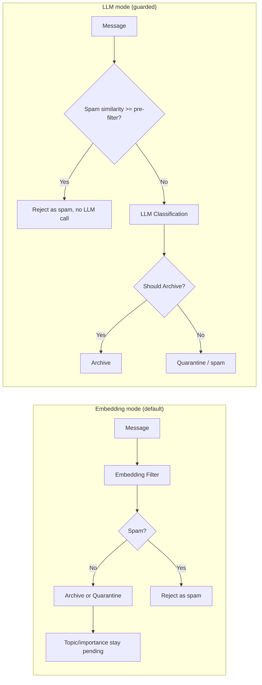

# Processing Modes

Configure how messages are classified and archived based on your hardware capabilities.

## Overview

The processor classifies every message in one of three ways. Which one runs is decided per message from runtime settings (admin UI, no restart):

| Mode | Speed | Hardware | Best For |
|------|-------|----------|----------|
| **Embedding mode** (`realtime_use_embedding=true`, default) | ~1-2s/message | CPU only | No LLM available, high volume. Topic and importance stay `pending` |
| **LLM mode** (`realtime_use_embedding=false`) | LLM-bound | LLM gateway or Ollama | Full classification (topic, importance, archive decision) |
| **Tier fallback** (`llm_classification_enabled=false`) | instant | none | No LLM and no embedding filter: archive-tier folders archive, the rest do not |

In LLM mode the embedding filter still runs around the LLM: obvious spam is rejected before the call (pre-filter), and if the LLM is unavailable the embedding verdict replaces it (fallback).

!!! note "Choosing a mode"
    `realtime_use_embedding=true` is the shipped default, so a fresh install starts in embedding mode. To get topic, importance and tags on every post, turn it off and point the platform at an LLM (see [External LLM](external-llm.md)).



!!! tip "Recommendation"
    Use **LLM mode** when you have an LLM endpoint: it is the only mode that fills topic, importance and tags. Use **embedding mode** when you have none, or to keep a deployment running while the LLM is down. Embedding mode archives on keywords and folder trust only: posts without a keyword from a non-archive folder are quarantined, not archived.

## Quick Configuration

### Via Admin UI (Recommended)

Navigate to **Admin → Configuration** (`/admin/config`) and find the **Processing** category:

| Setting | Default | Description |
|---------|---------|-------------|
| `realtime_use_embedding` | `true` | Live messages: decide with the embedding filter only (no LLM call) |
| `embedding_spam_filter_enabled` | `true` | Enable the embedding-based spam filter (enabling after the processor started with it off needs a restart) |
| `embedding_spam_threshold` | `0.75` | Spam similarity (0.0-1.0); spam needs no Ukraine keyword, or similarity above 0.90 |
| `embedding_off_topic_threshold` | `0.70` | Off-topic similarity; above it a post without keywords is quarantined |
| `llm_prefilter_spam_similarity` | `0.90` | LLM mode: spam similarity at or above which the LLM call is skipped (`1.0` disables; `.env.example` recommends `0.80` with the multilingual model) |
| `llm_classification_enabled` | `true` | LLM classification (topic, importance, archive decision) for messages the embedding filter does not decide |
| `llm_classifier_mode` | `unified` | `unified` (one prompt, production) or `modular` (three smaller prompts) |
| `backfill_fast_mode` | `false` | Backfilled messages use the embedding filter only (a reprocess request never does) |
| `ukraine_keywords_extra` | `[]` | Extra relevance keywords (JSON array) |


### Via Environment Variables

```bash
# .env file

# Embedding mode (no LLM needed)
REALTIME_USE_EMBEDDING=true
EMBEDDING_SPAM_FILTER_ENABLED=true
EMBEDDING_SPAM_THRESHOLD=0.75
BACKFILL_FAST_MODE=false            # true = backfill also embedding-only

# LLM mode (gateway or Ollama; see External LLM)
REALTIME_USE_EMBEDDING=false
LLM_ENABLED=true
LLM_PROVIDER=openai                 # or ollama / none
LLM_CLASSIFIER_MODE=unified
```

Environment values are the fallback; an admin override in `platform_config` wins, and values are cached about 30 seconds. After changing `.env`:

```bash
docker-compose up -d --force-recreate processor-worker processor-worker-backfill
```

## Processing Mode Details

### Embedding Mode

**How it works** (`services/processor/src/embedding_spam_filter.py`):

1. **Keyword check**: scans for Ukraine-related keywords (Україн, Херсон, Київ, ... plus `ukraine_keywords_extra`). Promotional footers are stripped first; a message that is only a promo footer without keywords is rejected.
2. **Embedding similarity**: cosine similarity against the reference examples in `spam_reference_examples` (categories `spam`, `ukraine_relevant`, `off_topic`).
3. **Decision logic**, in order:
    - spam similarity above 0.90 (any keywords) → spam, rejected
    - spam similarity above `embedding_spam_threshold` and no keywords → spam, rejected
    - archive-tier folder → archive (trust folder curation)
    - keywords present → archive
    - off-topic similarity above `embedding_off_topic_threshold` → quarantine (`off_topic_match`)
    - otherwise → quarantine (`no_ukraine_keywords`)

Topic and importance are not set in this mode (they stay `pending`); the backlog jobs or a later LLM pass fill them.

**Configuration:**

```bash
REALTIME_USE_EMBEDDING=true
EMBEDDING_SPAM_THRESHOLD=0.75       # Lower = more aggressive spam filtering
EMBEDDING_OFF_TOPIC_THRESHOLD=0.70
```

### LLM Mode

**How it works** (`message_processor.py`, `_classify_llm_guarded`):

1. **Pre-filter**: the embedding filter runs first; spam at or above `llm_prefilter_spam_similarity` is rejected without an LLM call.
2. **LLM classification**: the processor's classifier decides spam, relevance, topic, importance and archive. Post-LLM rules in code always apply: spam and non-Ukraine-relevant posts are never archived, and monitor/discover channels archive only posts at or above `monitoring_min_importance` (default `medium`).
3. **Fallback**: if the LLM is unavailable, the embedding verdict replaces it.

**When to use:** you have an LLM endpoint (OpenAI-compatible gateway or Ollama) and want topic, importance and tags on every archived post.

**Configuration:**

```bash
REALTIME_USE_EMBEDDING=false
LLM_ENABLED=true
LLM_PROVIDER=openai                 # gateway; see External LLM
LLM_GATEWAY_URL=...                 # .env only
LLM_CLASSIFIER_MODE=unified         # or "modular"
```

With `LLM_PROVIDER=ollama` the model comes from `OLLAMA_MODEL` (compose default `qwen2.5:3b`).

!!! note "Embedding model"
    The spam filter uses a model from `/models` (`EMBEDDING_SPAM_MODEL`, default in `.env.example`: `/models/paraphrase-multilingual-MiniLM-L12-v2`, 384 dimensions), provisioned by `scripts/fetch-models.sh`. Services never download models; see [Model Provisioning](model-provisioning.md). The English-only `all-MiniLM-L6-v2` performs very poorly on RU/UK posts.

## Hardware Recommendations

The processor itself needs only CPU (the embedding model is small). The LLM is the part that needs hardware, and it is normally remote.

| Situation | Setting |
|-----------|---------|
| No LLM available | `REALTIME_USE_EMBEDDING=true`, `LLM_PROVIDER=none` |
| GPU host with an OpenAI-compatible gateway | `REALTIME_USE_EMBEDDING=false`, `LLM_PROVIDER=openai` ([External LLM](external-llm.md)) |
| Local Ollama on CPU | Embedding mode; keep `OLLAMA_MODEL` small and use Ollama only for enrichment workers |

Size parallelism with the admin setting `processor_concurrency` (messages in flight per worker) so that workers x concurrency stays near the LLM lane cap; above it, requests wait on 429 backoff.

## Backfill Processing

For historical message processing, dedicated backfill workers are available:

```bash
# Start backfill workers (separate from realtime)
docker-compose --profile backfill up -d

# Scale backfill workers (default BACKFILL_WORKER_REPLICAS=2)
docker-compose --profile backfill up -d --scale processor-worker-backfill=4
```

Backfill workers:

- Are the only readers of the backfill stream (realtime workers never touch it), so without the `backfill` profile backfilled and gap-filled messages are never stored
- Use the LLM on the gateway's batch lane, or the embedding filter only when `backfill_fast_mode` is on
- Can run alongside realtime workers without interference

**Monitor backfill progress:**

```bash
# Check queue depth
docker-compose exec redis redis-cli XLEN telegram:messages:backfill

# View backfill worker logs
docker-compose logs -f processor-worker-backfill
```

## Tuning the Spam Filter

### Adjusting Thresholds

```bash
# Stricter (fewer false positives, may miss some spam)
EMBEDDING_SPAM_THRESHOLD=0.80       # Default: 0.75

# More aggressive (catches more spam, more false positives)
EMBEDDING_SPAM_THRESHOLD=0.70
```

### Adding Spam Examples

Add new spam patterns via the database:

```sql
INSERT INTO spam_reference_examples (category, subcategory, example_text, is_active)
VALUES ('spam', 'crypto_scam', 'Earn 1000% returns with our token...', true);
```

Or via NocoDB UI if enabled. Examples are reloaded every `EMBEDDING_CACHE_REFRESH_INTERVAL` seconds (default 300). Thresholds are per embedding model: recalibrate them if you change `EMBEDDING_SPAM_MODEL`.

### Adding Ukraine Keywords

Keywords can be added via the **database** (no rebuild required) or the code.

=== "Via Admin UI (Recommended)"

    Navigate to **Admin → Configuration** (`/admin/config`) and find `ukraine_keywords_extra` in the **Processing** category. Keywords are matched as case-insensitive substrings.

    The value is a JSON array of additional keywords:

    ```json
    ["часів яр", "торецьк", "угледар", "купянськ", "обстріл"]
    ```

    Changes take effect within 5 minutes (next cache refresh).

=== "Via SQL"

    ```sql
    -- Add a keyword to the database
    UPDATE platform_config
    SET value = value::jsonb || '["new_keyword"]'::jsonb
    WHERE key = 'ukraine_keywords_extra';
    ```

=== "Via Code"

    Edit `UKRAINE_KEYWORDS` in `services/processor/src/embedding_spam_filter.py` (regex patterns):

    ```python
    UKRAINE_KEYWORDS = [
        r'україн|ukrain|украин',
        r'київ|kyiv|kiev|киев',
        r'херсон|kherson',
        # Add new patterns here
    ]
    ```

    Then rebuild:

    ```bash
    docker-compose build processor-worker processor-worker-backfill
    docker-compose up -d --force-recreate processor-worker processor-worker-backfill
    ```

### Automated False Positive Detection

An optional cron job (not installed by default) can detect and fix false positives (Ukraine-related content incorrectly marked as spam). Install it as described in the header of `scripts/cron_fix_spam.sh` (every 4 hours, logging to journald):

```bash
# Example crontab entry
0 */4 * * * /path/to/platform/scripts/cron_fix_spam.sh 2>&1 | logger -t osint-spam-fix

# Run manually (optional argument: lookback hours, default 6)
./scripts/cron_fix_spam.sh

# View logs (uses journald)
journalctl -t osint-spam-fix --since "1 day ago"
journalctl -t osint-spam-fix -f  # follow in real-time
```

The script:

1. Finds recent messages marked as spam that contain Ukraine keywords
2. Reclassifies them as non-spam
3. Logs the count of fixed messages to journald

## Monitoring Processing

### Key Metrics

| Metric | Location | Target |
|--------|----------|--------|
| Processing time | Grafana → Processor | <5s (embedding), LLM-bound otherwise |
| Queue depth | Redis `XLEN` | <1000 (realtime) |
| Spam rate | Decision log | 10-30% typical |
| Archive rate | Decision log | 70-90% typical |

### Decision Log Analysis

```sql
-- Check recent classification decisions
SELECT
    decision_value->>'is_spam' as is_spam,
    decision_value->>'relevance_reason' as reason,
    COUNT(*) as count
FROM decision_log
WHERE decision_type = 'classification'
AND created_at > NOW() - INTERVAL '1 hour'
GROUP BY 1, 2
ORDER BY 3 DESC;
```

### Verify Spam Quality

```sql
-- Sample messages marked as spam
SELECT
    SUBSTRING(m.content, 1, 200) as content,
    dl.decision_value->>'relevance_reason' as reason
FROM decision_log dl
JOIN messages m ON dl.message_id = m.id
WHERE (dl.decision_value->>'is_spam')::boolean = true
ORDER BY dl.created_at DESC
LIMIT 10;
```

## Troubleshooting

### Messages Processing Too Slowly

**Symptom:** Queue depth growing, >30s per message. Check the LLM first (gateway reachable, lane not paused after 401/403, `processor_concurrency` not above the lane cap).

**Solution:**
```bash
# Switch to embedding mode (admin setting realtime_use_embedding, or .env)
REALTIME_USE_EMBEDDING=true

# Restart workers if you changed .env
docker-compose up -d --force-recreate processor-worker
```

### Legitimate Content Marked as Spam

**Symptom:** War-related content being filtered

**Solution:**

1. Check if content has Ukraine keywords
2. Raise the spam threshold (`EMBEDDING_SPAM_THRESHOLD=0.80`; higher = fewer false positives)
3. Add missing keywords to `ukraine_keywords_extra`
4. Check the embedding model: the English-only `all-MiniLM-L6-v2` mislabels RU/UK posts

### High CPU Usage from a Local Ollama

**Symptom:** Ollama using 100% CPU constantly

**Solution:** move LLM work to a GPU gateway ([External LLM](external-llm.md)), or switch to embedding mode (`REALTIME_USE_EMBEDDING=true`).

### Backfill Not Progressing

**Symptom:** Backfill queue not draining

**Solution:**
```bash
# Check if backfill workers are running
docker-compose ps | grep backfill

# Start backfill workers
docker-compose --profile backfill up -d

# Scale up
docker-compose --profile backfill up -d --scale processor-worker-backfill=4
```

## Architecture Details

### Decoupled Design

Archiving decisions are separated from LLM classification. With `realtime_use_embedding=true` a message is stored in 1-2 seconds with no LLM call; topic and importance are filled later (backlog jobs). With the LLM on, the embedding filter guards the call (pre-filter and fallback) so an LLM outage never blocks archiving.

```
Embedding mode:  Message → Embedding Filter → Archive decision → Store (topic pending)
LLM mode:        Message → Embedding pre-filter → LLM → Archive decision → Store
                                  (LLM down: embedding verdict is used)
```

### Embedding Spam Filter

Uses `sentence-transformers` with the model at `EMBEDDING_SPAM_MODEL` (a path under `/models`):

- 384-dimensional embeddings
- Cosine similarity against reference examples
- Categories: `spam`, `ukraine_relevant`, `off_topic`
- Keyword rule: Ukraine keywords stop a post from being rejected as spam unless similarity is above 0.90

### LLM Classifier

Calls the configured provider (`LLM_PROVIDER`: `openai` gateway, `ollama`, or `none`):

- Unified mode: single prompt for all classification (prompt rows in `llm_prompts`, versioned)
- Returns: spam, relevance, topic, importance, archive recommendation and an `analysis` audit trail

## Related Documentation

- [Configuration Reference](configuration.md) - All environment variables
- [Performance Tuning](performance-tuning.md) - Optimization strategies
- [Monitoring](monitoring.md) - Grafana dashboards
- [Processor Service](../developer-guide/services/processor.md) - Technical details
