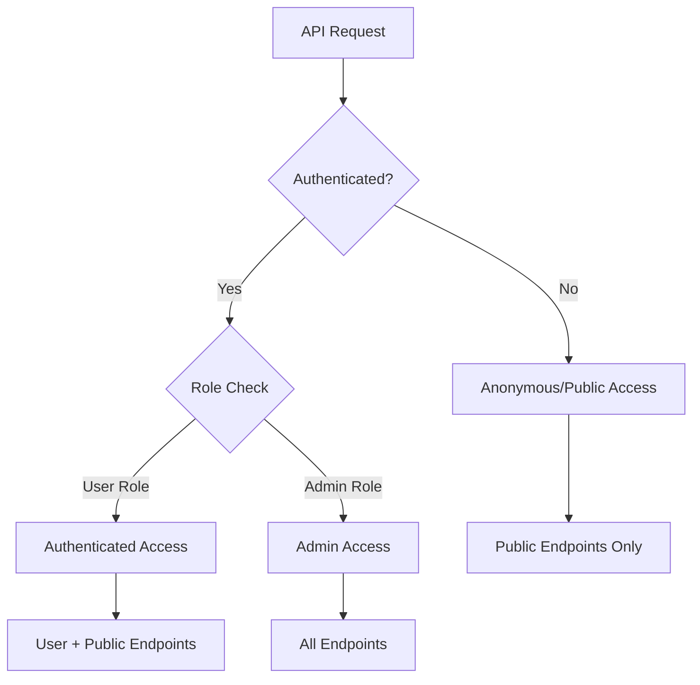

# Authorization

Role-based access control and permissions management for the OSINT Intelligence Platform.

## Overview

The platform implements a **three-tier access model** based on user roles and authentication status. Authorization is enforced in two places: Oathkeeper rules at the proxy (for `/api/admin`, `/api/users`, `/api/spam-review`, `/api/rules`, Prometheus) and FastAPI dependencies inside the API (`AuthenticatedUser`, `AdminUser`).

Roles come from the Kratos identity's `metadata_public.role`. Values the API accepts from Oathkeeper are `anonymous`, `authenticated`, `admin`, `moderator`, `api_key` and `api_user`. The admin user API (`/api/admin/users`) manages three assignable roles: `admin`, `analyst` and `viewer` (hierarchy admin > analyst > viewer, used by the Oathkeeper role-check endpoint for tools such as Grafana).

## Access Control Model

### Three-Tier Access



### Access Tiers

| Tier | Authentication | Role | Access Level |
|------|---------------|------|--------------|
| **PUBLIC** | Not required | None | Read-only search, channels, messages, events, map, analytics, RSS feeds (signed token when `FEED_AUTH_REQUIRED=true`) |
| **AUTHENTICATED** | Required | any logged-in role | Bookmarks, preferences, feed tokens, API keys |
| **ADMIN** | Required | `admin` | Spam review, user management, system config, prompts, export |

## Built-in Roles

### Anonymous (Public)

**No authentication required** - Read-only access to OSINT data.

**Permissions:**

- Search messages (`GET /api/messages`, `GET /api/search`)
- View channels (`GET /api/channels`) and events (`GET /api/events`)
- Access RSS feeds (`GET /rss/*`; requires a signed token when `FEED_AUTH_REQUIRED=true`, the default)
- View analytics (`GET /api/analytics/*`), the map (`GET /api/map/*`) and timeline (`GET /api/timeline`)

**Philosophy:**

Public access to OSINT data maximizes accessibility for researchers, journalists, and analysts. No registration friction enables immediate research.

### User (Authenticated)

**Authentication required** - Personal features and preferences.

**Additional Permissions:**

- Manage bookmarks (`GET /api/bookmarks/`, `POST/DELETE /api/bookmarks/{message_id}`)
- Update preferences (`GET/PUT /api/user/preferences`)
- Generate feed tokens (`POST /api/feed-tokens`) and API keys (`POST /api/api-keys`)
- View user profile (`GET /api/user/me`)

**Use Cases:**

- Researchers saving important messages
- Analysts customizing search preferences
- RSS subscribers generating personal feed URLs

### Admin

**Authentication + admin role required** - System management and moderation.

**Additional Permissions:**

- Review spam decisions (`POST /api/spam/messages/{id}/mark-not-spam`, `/api/admin/spam/*`)
- Manage users and sessions (`GET/POST/PUT/DELETE /api/admin/users`)
- Access and change runtime settings (`/api/admin/config`)
- Export data (`/api/admin/export`)
- Manage LLM prompts (`/api/admin/prompts`)
- System operations (`/api/admin/system`)

**Responsibilities:**

- Reviewing spam filter false positives
- Managing user accounts and roles
- Configuring platform settings
- Monitoring system health
- Investigating security incidents

## Permission Model

### FastAPI Dependency Injection

Authorization is enforced using FastAPI dependencies from `services/api/src/dependencies/auth.py`:

```python
from ..dependencies.auth import AuthenticatedUser, AdminUser, CurrentUser

# Public endpoint (no authentication)
@router.get("/api/messages")
async def search_messages():
    return results

# Authenticated endpoint (login required)
@router.get("/api/user/preferences")
async def get_prefs(user: AuthenticatedUser):
    # user.user_id, user.email, user.roles are available
    return prefs

# Admin endpoint (admin role required)
@router.post("/api/spam/messages/{message_id}/mark-not-spam")
async def mark_not_spam(message_id: int, user: AdminUser):
    return result
```

### Dependency Functions

- **`CurrentUser`** (`get_current_user`) - returns the user context; anonymous users are returned as an anonymous user, not rejected
- **`AuthenticatedUser`** (`require_auth`) - raises `401 Unauthorized` ("Authentication required") if not authenticated; also validates `ak_` API keys
- **`AdminUser`** (`require_admin`) - raises `401` if not authenticated and `403 Forbidden` ("Admin access required") if the user is not an admin
- **`require_role("analyst")`** - factory for a specific role (`403 Role 'analyst' required`)

`AuthUser.is_admin` is true for the roles `admin` and `administrator`.

## API Endpoint Protection

### Public Endpoints (No Auth Required)

All **GET** operations on OSINT data are public to maximize accessibility. Even with `AUTH_REQUIRED=true`, the API's auth middleware lets these through:

```
GET /api/messages              # Search/list messages
GET /api/channels              # List channels
GET /api/events                # Detected events
GET /api/map/*                 # Map data
GET /api/search                # Full-text search
GET /api/about/*               # Platform information
GET /api/analytics/*           # Analytics dashboards
GET /api/timeline              # Timeline views
GET /rss/*                     # RSS/Atom/JSON feeds (token+sig when FEED_AUTH_REQUIRED=true)
GET /health, /api/health       # Health checks
GET /docs                      # API documentation
```

Other read routers (semantic search, entities, network graph, ...) follow the per-router dependency: check `/docs` (role-filtered) or `services/api/ENDPOINT_PROTECTION.md` in the code repository for the authoritative list.

### Authenticated Endpoints (Login Required)

User-specific features require authentication:

```
GET    /api/bookmarks/            # List user's bookmarks
POST   /api/bookmarks/{msg_id}    # Add bookmark
DELETE /api/bookmarks/{msg_id}    # Remove bookmark

GET /api/user/me                  # Current user info
GET /api/user/preferences         # User preferences
PUT /api/user/preferences         # Update preferences

GET    /api/feed-tokens           # List feed tokens
POST   /api/feed-tokens           # Create token
DELETE /api/feed-tokens/{id}      # Revoke token
POST   /api/feed-tokens/{id}/sign-url   # Sign a feed URL

GET/POST/DELETE /api/api-keys     # Personal API keys
```

### Admin Endpoints (Admin Role Required)

System management requires the admin role:

```
POST /api/spam/messages/{id}/mark-not-spam    # Review spam
POST /api/spam/messages/{id}/confirm-spam
GET/PUT/POST/DELETE /api/admin/spam/*         # Spam queue management

GET/PUT /api/admin/config/*    # Runtime settings and model config
GET/POST/PUT /api/admin/prompts/*   # LLM prompt management
GET/POST/PUT/DELETE /api/admin/users/*   # Kratos identities, roles, sessions
GET/POST /api/admin/export/*   # Data export jobs
```

### Feed Token Authorization

Feed URLs are authorized by a feed token plus an HMAC signature, not by a user session:

```bash
GET /rss/search?q=ukraine&token=<token-id>&sig=<hmac>

# API validates:
# 1. Token exists and is active (not revoked)
# 2. HMAC signature over the query parameters is valid
```

Feed tokens carry no scopes: any valid token can read any feed, and the signature binds the exact query string. See [Authentication](authentication.md#feed-token-authentication).

## Error Responses

### 401 Unauthorized

Returned when authentication is **required** but user is not logged in.

```json
{
  "detail": "Authentication required"
}
```

**Common Causes:**

- No `Authorization` header (JWT / API key)
- Invalid or expired JWT, revoked API key
- Missing or expired `ory_kratos_session` cookie (Ory Kratos)

**Frontend Action:**

Redirect user to login page.

### 403 Forbidden

Returned when user is **authenticated** but lacks required permissions.

```json
{
  "detail": "Admin access required"
}
```

**Common Causes:**

- Authenticated user accessing an admin endpoint
- User role is not "admin"
- Trying to demote or delete yourself, or the last admin, via `/api/admin/users`

**Frontend Action:**

Display "Access Denied" message.

## User Role Management

### Assigning Admin Role

**First admin (Ory Kratos):** set `INITIAL_ADMIN_EMAIL` (and optionally `INITIAL_ADMIN_PASSWORD`) in `.env`. The `kratos-init` container creates an identity with `metadata_public.role = "admin"` if no admin exists yet.

**Later changes (admin API):**

```bash
# Create a user with a role (admin session required)
curl -X POST https://your-domain.com/api/admin/users \
  -H "Content-Type: application/json" -H "Cookie: <admin session cookie>" \
  -d '{"email":"analyst@example.com","role":"analyst"}'

# Change a role
curl -X PUT https://your-domain.com/api/admin/users/<user_id> \
  -H "Content-Type: application/json" -H "Cookie: <admin session cookie>" \
  -d '{"role":"viewer"}'
```

Valid roles are `admin`, `analyst` and `viewer`. The API refuses to demote yourself or remove the last admin. The same operations are available in the admin UI.

**JWT mode:** the built-in `admin` user has all roles; admins add users with `POST /auth/users` and a `roles` list.

### Checking User Role

```bash
curl https://your-domain.com/api/user/me -H "Cookie: <session cookie>"
```

The response contains the user's identity and role.

## Feed Token Permissions

Feed tokens are unscoped; control access by creating one token per consumer and revoking it when the consumer should lose access. Each user may hold at most 10 active tokens.

```bash
# List your tokens
curl https://your-domain.com/api/feed-tokens -H "Cookie: <session cookie>"

# Revoke a token
curl -X DELETE https://your-domain.com/api/feed-tokens/<token-id> -H "Cookie: <session cookie>"
```

### API Key Scopes

API keys (`/api/api-keys`) do carry scopes: `read`, `write`, `media`, `export`, `admin`. Only admins can create keys with the `admin` scope.

## Resource-Level Access Control

Access is role-based only. There is no row-level security, per-channel or per-team access control and no Ory Keto integration in the current code; every authenticated user sees the same OSINT data. If you need to restrict data per user, do it at the proxy or run separate instances.

## Audit Logging

Admin actions are written to the `admin_audit_log` table (who, action, target, timestamp). Auth failures show up in the API log:

```bash
# Rejected requests
docker-compose logs -f api | grep -E "401|403"

# Recent admin audit entries
docker-compose exec -T postgres psql -U osint_user -d osint_platform -c \
  "SELECT * FROM admin_audit_log ORDER BY created_at DESC LIMIT 20;"
```

## Security Best Practices

### Principle of Least Privilege

!!! tip "Best Practice"
    Grant users only the minimum permissions required for their role. Most users should have "user" role, not "admin".

**Guidelines:**

- Default new users to "user" role
- Promote to admin only when necessary
- Regularly review admin user list
- Revoke admin when no longer needed

### Regular Permission Audits

Roles live in Kratos, not in the application database. List admins through the admin API:

```bash
curl "https://your-domain.com/api/admin/users?role=admin" -H "Cookie: <admin session cookie>"
```

Review the list monthly and remove admins who no longer need the role.

### Separation of Duties

- **Viewers** - read access, personal bookmarks and feeds
- **Analysts** - `analyst` role (hierarchy above viewer; used for protected tooling)
- **System admins** - `admin` role (full access)

### Time-Limited Elevated Access

There is no automatic role expiry. For temporary admin tasks, promote with `PUT /api/admin/users/{id}` and demote afterwards.

## Testing Authorization

### Test Public Access

```bash
# Should work without authentication
curl -s -o /dev/null -w "%{http_code}\n" http://localhost:8000/api/messages
curl -s -o /dev/null -w "%{http_code}\n" http://localhost:8000/api/channels
```

### Test User and Admin Access (JWT mode)

```bash
USER_TOKEN=$(curl -s -X POST http://localhost:8000/auth/login \
  -H "Content-Type: application/json" \
  -d '{"username":"analyst1","password":"password"}' | jq -r '.access_token')

# Authenticated endpoint works
curl http://localhost:8000/api/bookmarks/ -H "Authorization: Bearer $USER_TOKEN"

# Admin endpoint is refused
curl -X POST http://localhost:8000/api/spam/messages/123/mark-not-spam \
  -H "Authorization: Bearer $USER_TOKEN"
# Expected: 403 {"detail":"Admin access required"}
```

Repeat with the `admin` token to confirm admin endpoints work. In Ory mode, test through the browser session or an API key (`Authorization: Bearer ak_...`).

## Troubleshooting

### User Can't Access Authenticated Endpoint

```bash
curl -i http://localhost:8000/api/user/me -H "Authorization: Bearer $TOKEN"
```

A `401` means the token or session is invalid or expired: log in again.

### Authenticated User Gets 403 Forbidden

Check the role returned by `GET /api/user/me`. If it is not `admin` but the endpoint requires it, an admin must change the role via `PUT /api/admin/users/{id}`. In Ory mode, a role change takes effect on the user's next request (the role is read from the Kratos identity).

### Feed Token Access Denied

**Check token status:**

```bash
# List user's tokens
curl https://your-domain.com/api/feed-tokens \
  -H "Cookie: <session cookie>"
```

**Common Issues:**

- Token was revoked
- HMAC signature invalid because a query parameter changed (sign the URL again)

## Not Implemented

These are **not** in the current code: per-channel/row-level access control, Ory Keto relationship-based permissions, OAuth2-style API scopes for user sessions, and time-limited role escalation. Roles beyond `admin`/`analyst`/`viewer` are accepted by the API but have no dedicated permissions.

## Related Documentation

- [Authentication Guide](authentication.md) - User authentication setup
- [API Endpoint Protection](https://github.com/osintukraine/osint-intelligence-platform/blob/master/services/api/ENDPOINT_PROTECTION.md) - Complete endpoint catalog
- [Security Hardening](hardening.md) - Production security practices

---

!!! info "Public OSINT Philosophy"
    The platform prioritizes public access to OSINT data for maximum research impact. Authorization protects user data and administrative functions, not intelligence data itself.
