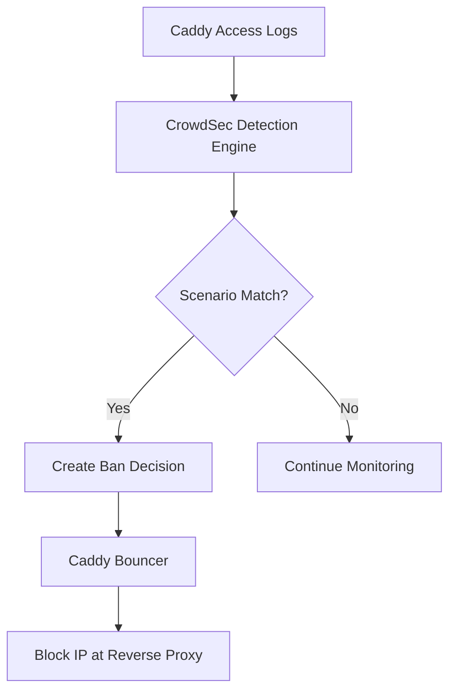

# CrowdSec Integration

Intrusion prevention and threat detection using CrowdSec for production deployments of the OSINT Intelligence Platform.

## Overview

[CrowdSec](https://crowdsec.net/) is an open-source intrusion prevention system (IPS) that provides real-time threat detection and automated response through IP blocking. The platform integrates CrowdSec with custom OSINT-specific security scenarios to protect against:

- API abuse and automated scraping
- Brute force authentication attacks
- Bot traffic and automated tools
- Data extraction attempts
- Admin interface reconnaissance

## What is CrowdSec?

**CrowdSec** combines behavior-based detection with community-driven threat intelligence:

**Key Features:**

- **Behavioral analysis** - Detects attacks by analyzing patterns, not signatures
- **Community intelligence** - Shares attack data to protect all users
- **Custom scenarios** - Platform-specific threat detection rules
- **Multiple bouncers** - Block at reverse proxy, firewall, or application level
- **Low overhead** - Small CPU/memory footprint

**How It Works:**



## Architecture

The CrowdSec integration uses a **defense-in-depth** approach:

```
Internet Traffic
     ↓
Caddy Reverse Proxy + CrowdSec Bouncer ← Blocks banned IPs
     ↓ (allowed traffic only)
Application Services (API, Frontend, NocoDB, Grafana)
     ↓ (access logs)
CrowdSec Detection Engine ← Analyzes patterns
     ↓ (ban decisions)
IP Bans enforced by Caddy Bouncer
```

**Components:**

- **CrowdSec Engine** - Analyzes logs and creates ban decisions
- **Caddy Bouncer** - Enforces bans at reverse proxy level
- **Custom Scenarios** - OSINT platform-specific threat detection
- **Dashboard** - Web UI for monitoring (optional)

## Installation

CrowdSec and Caddy are defined in `docker-compose.yml` under the `auth` profile (together with Kratos and Oathkeeper). For production, `docker-compose.production.yml` overrides them (CrowdSec adds the `caddy`, `http-cve` and other collections plus host log sources; Caddy becomes `osint-caddy-secured` with the CrowdSec bouncer module and `infrastructure/caddy/Caddyfile.security`). Enable it with:

```bash
# .env
COMPOSE_FILE=docker-compose.yml:docker-compose.production.yml
COMPOSE_PROFILES=...,auth
```

!!! note "Legacy file"
    `docker-compose.security.yml` is an older stand-alone variant of this stack. Prefer the production overlay above; do not combine all three files.

### First-Time Setup

**Step 1: Generate the bouncer API key**

```bash
# Runs CrowdSec in isolation and writes the keys to .env
./scripts/setup-crowdsec.sh
```

Or manually, after starting CrowdSec:

```bash
docker exec osint-crowdsec cscli bouncers add caddy-bouncer -o raw
# put the output in .env as CROWDSEC_BOUNCER_API_KEY
```

**Step 2: Start the auth profile stack**

```bash
docker-compose up -d     # with COMPOSE_PROFILES including "auth"
```

On first startup, CrowdSec automatically installs its collections, loads the custom OSINT scenarios and `profiles.yaml` from mounted volumes, and starts the Local API for the bouncer.

**Step 3: Recreate Caddy if you added the key afterwards**

```bash
docker-compose up -d --force-recreate caddy
```

**Step 5: Verify Installation**

```bash
# Check CrowdSec is healthy
docker exec osint-crowdsec cscli lapi status

# Verify bouncer is connected (should show caddy-bouncer)
docker exec osint-crowdsec cscli bouncers list

# Check scenarios are loaded (hub scenarios plus the 10 custom osint/* ones)
docker exec osint-crowdsec cscli scenarios list | head -20

# Verify OSINT scenarios specifically
docker exec osint-crowdsec cscli scenarios list | grep osint

# Check Caddy logs are being parsed
docker exec osint-crowdsec cscli metrics
```

### What Gets Auto-Installed

The `COLLECTIONS` variable triggers installation of hub collections on first start:

| Where | Collections |
|-------|-------------|
| `docker-compose.yml` | `crowdsecurity/caddy` (Caddy log parser plus HTTP scenarios) |
| `docker-compose.production.yml` | `linux`, `caddy`, `nginx`, `http-cve`, `whitelist-good-actors`, `iptables`, `base-http-scenarios` (plus selected parsers and scenarios such as `http-sqli`, `http-xss`, `http-sensitive-files`) |

The production overlay also mounts `/var/log/auth.log` and `/var/log/syslog` from the host as log sources.

### Custom OSINT Scenarios

Ten platform-specific scenarios live in `infrastructure/crowdsec/scenarios/`. The ban durations come from `infrastructure/crowdsec/profiles.yaml`; scenarios without their own profile (`rss-abuse`, `kratos-enum`, `minio-abuse`, `monitoring-abuse`) get the default 4 hour ban.

| Scenario | Ban | Trigger (leaky bucket) |
|----------|-----|------------------------|
| `osint/api-abuse` | 6 h | 30+ distinct `/api/` paths answering 401/403/429 (probing; busy public read paths are excluded) |
| `osint/auth-bruteforce` | 24 h | 3 failed (400/401/403/422) requests to `/auth/` within 60 s |
| `osint/admin-abuse` | 48 h | 5+ 401/403 responses on NocoDB, Grafana, ntfy, docs or Kratos-admin paths within 60 s |
| `osint/search-abuse` | 12 h | 60+ distinct `/api/search` or `/api/semantic` paths (bucket leaks one event per 5 s) |
| `osint/data-extraction` | 72 h | 400+ distinct successful (200) `/api/` paths (bucket leaks one event per second) |
| `osint/rss-abuse` | 4 h (default) | 20+ 401/403 responses on `/rss/` (bad or missing feed tokens) |
| `osint/suspicious-ua` | 1 h | 15+ requests with a bot/curl/wget/python-style user agent in 60 s; known crawlers and link-preview bots (Googlebot, Telegram, Facebook, ...) are excluded |
| `osint/kratos-enum` | 4 h (default) | 10+ distinct registration/recovery/verification requests under `/kratos/self-service/` |
| `osint/minio-abuse` | 4 h (default) | 10+ 401/403/404 responses on `/minio/` or `/osint-media/` |
| `osint/monitoring-abuse` | 4 h (default) | 5+ 401/403 responses on Prometheus, Alertmanager or `/metrics` |

Additionally, `profiles.yaml` bans anything matching `CVE` or `exploit` for 168 h. Treat the numbers above as defaults that are tuned over time: the YAML files are the source of truth.

## Security Scenarios

### Standard WAF Protection

CrowdSec includes built-in web application firewall scenarios:

**HTTP Attack Prevention:**

- `crowdsecurity/http-sqli` - SQL injection detection
- `crowdsecurity/http-xss` - Cross-site scripting prevention
- `crowdsecurity/http-sensitive-files` - Sensitive file access attempts
- `crowdsecurity/http-crawl-non_statics` - Aggressive crawling detection
- `crowdsecurity/http-generic-bf` - Generic brute force protection

**Network Attacks:**

- `crowdsecurity/iptables-scan-multi_ports` - Port scanning detection
- `crowdsecurity/http-bad-user-agent` - Known malicious user agents

### OSINT Platform-Specific Scenarios

The custom scenarios use field mappings from the `crowdsecurity/caddy-logs` parser. Read the files in `infrastructure/crowdsec/scenarios/` for the exact filters and thresholds rather than relying on copies in documentation.

!!! note "Field Mapping Reference"
    - `evt.Meta.log_type` = `http_access-log` (set by Caddy parser)
    - `evt.Meta.http_path` = Request URI (e.g., `/api/messages`)
    - `evt.Meta.http_status` = HTTP status code (e.g., `200`, `401`)
    - `evt.Meta.http_user_agent` = User-Agent header
    - `evt.Meta.source_ip` = Client IP address

Example (`osint/auth-bruteforce`):

```yaml
name: osint/auth-bruteforce
type: leaky
filter: "evt.Meta.log_type == 'http_access-log' && evt.Meta.http_path contains '/auth/' && evt.Meta.http_status in ['400', '401', '403', '422']"
leakspeed: "60s"
capacity: 5
groupby: "evt.Meta.source_ip"
condition: "len(queue.Queue) >= 3"
blackhole: 900s
```

Design notes from the current files:

- **`api-abuse`** only counts unauthorized responses and excludes busy public paths (`/api/map/`, `/api/messages`, `/api/channels`, `/api/semantic/`, ...), so normal browsing never triggers it.
- **`suspicious-ua`** excludes search-engine and link-preview crawlers, because banning them breaks link previews on Telegram, Facebook and X.
- **`data-extraction`** and **`search-abuse`** use high thresholds to avoid banning the frontend's own parallel requests.
- A scenario that uses `blackhole` suppresses repeat alerts for the same IP for that period.

## Rate Limiting

Caddy applies per-IP rate limits before CrowdSec sees abusive behaviour (`infrastructure/caddy/Caddyfile.security`):

| Zone | Limit | Applies to |
|------|-------|------------|
| `static_files` | 30 req/min | static assets |
| `api_calls` | 60 req/min | `/api/*` |
| `auth_attempts` | 10 per 5 minutes | `/kratos/*` |
| `admin_access` | 20 per 10 minutes | admin routes |
| `rss_feeds` | 30 per 2 minutes | `/rss/*` |
| `frontend` | 120 req/min | frontend pages |

Exceeding a Caddy limit returns HTTP 429; the CrowdSec scenarios then decide on bans.

## Monitoring and Management

### Access Points

**CrowdSec Dashboard (optional):**

The dashboard (`crowdsec-dashboard`, `auth` profile in the production overlay) listens on `127.0.0.1:3010` only. Reach it through an SSH tunnel:

```bash
./scripts/tunnel-crowdsec-dashboard.sh user@your-server
# then open http://localhost:3010
```

It needs `CROWDSEC_DASHBOARD_API_KEY` in `.env`.

**CrowdSec Metrics:**

```bash
# Prometheus metrics (bound to 127.0.0.1 on the host)
curl http://127.0.0.1:6060/metrics
```

**Grafana Integration:** Prometheus scrapes the CrowdSec metrics endpoint when the `monitoring` profile is active; use the Grafana instance described in [Monitoring](../operator-guide/monitoring.md).

### Management Commands

**View Active Bans:**

```bash
# List all current decisions (bans)
docker-compose exec crowdsec cscli decisions list

# View bans by IP
docker-compose exec crowdsec cscli decisions list --ip 192.168.1.100

# View bans by scenario
docker-compose exec crowdsec cscli decisions list --type ban
```

**Unban an IP:**

```bash
# Remove ban for specific IP
docker-compose exec crowdsec cscli decisions delete --ip 192.168.1.100

# Remove ALL decisions (careful)
docker-compose exec crowdsec cscli decisions delete --all
```

**View Detection Metrics:**

```bash
# Summary of detection activity
docker-compose exec crowdsec cscli metrics

# Bouncer status
docker-compose exec crowdsec cscli bouncers list
```

**Hub Management:**

```bash
# List installed scenarios
docker-compose exec crowdsec cscli scenarios list

# Update scenarios from hub
docker-compose exec crowdsec cscli hub update

# Upgrade installed scenarios
docker-compose exec crowdsec cscli hub upgrade
```

**Configuration Validation:**

```bash
# Check configuration
docker-compose exec crowdsec crowdsec -t

# Reload: restart the container
docker-compose restart crowdsec
```

### Log Analysis

**Monitor CrowdSec Logs:**

```bash
# Watch detection events
docker-compose logs -f crowdsec

# Filter for specific scenario
docker-compose logs crowdsec | grep "osint/api-abuse"

# View ban decisions
docker-compose logs crowdsec | grep "decision"
```

**Monitor Caddy Access Logs:**

```bash
# Watch incoming requests
docker-compose exec caddy tail -f /var/log/caddy/access.log   # service is "caddy" (container osint-caddy-secured in production)

# Filter for blocked IPs
docker-compose logs caddy | grep crowdsec | grep blocked
```

**View Bouncer Decision Logs:**

```bash
# See what bouncer is blocking
docker-compose logs -f caddy | grep crowdsec
```

## Whitelisting

### Whitelist Trusted IPs

**Temporary (decision-level):**

```bash
# Remove an existing ban
docker-compose exec crowdsec cscli decisions delete --ip 192.168.1.100
```

**Permanent (post-overflow whitelist):**

The platform ships `infrastructure/crowdsec/whitelists/owner-ips.yaml`, mounted into `/etc/crowdsec/postoverflows/s01-whitelist/`. It exempts one IP from the site-usage scenarios only (`search-abuse`, `data-extraction`, `api-abuse`, `admin-abuse`); authentication and attack scenarios still apply. Replace the example IP with your own (use a stable address; a reassigned dynamic IP passes its exemption to the next holder), then restart CrowdSec:

```yaml
name: osint/owner-whitelist
description: "Owner IP: exempt from the site-usage scenarios only"
whitelist:
  reason: "Owner IP - site usage never banned"
  expression:
    - >-
      evt.Overflow.Alert.Source.IP in ['203.0.113.10'] &&
      evt.Overflow.Alert.Scenario in ['osint/search-abuse', 'osint/data-extraction', 'osint/api-abuse', 'osint/admin-abuse']
```

```bash
docker-compose restart crowdsec
```

### Docker and Private Networks

`infrastructure/crowdsec/config.yaml` already lists `172.16.0.0/12`, `192.168.0.0/16` and `10.0.0.0/8` as `trusted_ips` for the Local API. Behind Cloudflare, the `cloudflare-real-ip` parser takes the client address from `Cf-Connecting-Ip` so bans apply to real visitors; the `cloudflare` profile adds a bouncer that syncs bans to Cloudflare (`infrastructure/crowdsec/cloudflare-bouncer.yaml.example`).

## Performance Impact

CrowdSec and the Caddy bouncer add a small per-request overhead and modest memory use (the engine uses a local SQLite database under `/var/lib/crowdsec/data`). Measure on your own hardware with `docker stats osint-crowdsec`; no benchmark numbers are maintained here.

## Troubleshooting

### Bouncer Not Blocking IPs

**Check bouncer status:**

```bash
# Verify bouncer is connected
docker-compose exec crowdsec cscli bouncers list

# Should show: caddy-bouncer (active)
```

**Verify API key:**

```bash
# Check .env has correct key
grep CROWDSEC_BOUNCER_API_KEY .env

# Regenerate if needed
docker-compose exec crowdsec cscli bouncers delete caddy-bouncer
docker-compose exec crowdsec cscli bouncers add caddy-bouncer -o raw
```

**Test decision creation:**

```bash
# Manually ban your own test IP (use a throwaway address you control)
docker-compose exec crowdsec cscli decisions add \
  --ip <test-ip> \
  --duration 10m \
  --reason "Test ban"

# Request from that IP; Caddy should answer 403
curl -I https://your-domain.com/
# Remove the test ban afterwards
docker-compose exec crowdsec cscli decisions delete --ip <test-ip>
```

### False Positives

**Whitelist legitimate traffic:**

```bash
# Unban false positive
docker-compose exec crowdsec cscli decisions delete --ip YOUR_IP

# Add to infrastructure/crowdsec/whitelists/owner-ips.yaml (see Whitelisting), then
docker-compose restart crowdsec
```

**Adjust scenario thresholds:**

Edit the scenario file, for example `infrastructure/crowdsec/scenarios/osint-search-abuse.yaml`, then restart CrowdSec:

```yaml
# Raise the trigger condition and capacity for less sensitivity
capacity: 200
condition: "len(queue.Queue) >= 120"
```

### Scenarios Not Triggering

**Verify logs are being parsed:**

```bash
# Test log parsing
docker-compose exec crowdsec cscli explain \
  --file /var/log/caddy/access.log \
  --type caddy
```

**Check scenario status:**

```bash
# List installed scenarios
docker-compose exec crowdsec cscli scenarios list

# Should show osint/* scenarios
```

**Validate scenario syntax:**

```bash
# Check configuration
docker-compose exec crowdsec crowdsec -t
```

### High False Positive Rate

**Review ban reasons:**

```bash
# See why IPs are being banned
docker-compose exec crowdsec cscli alerts list

# Filter by scenario
docker-compose exec crowdsec cscli alerts list --scenario osint/api-abuse
```

**Tune scenario parameters:**

```yaml
# Make detection less aggressive: raise `condition` and `capacity`, or add exclusions to the filter
```

## Security Best Practices

### Operational Security

**Regular Updates:**

```bash
# Update scenarios weekly
docker-compose exec crowdsec cscli hub update
docker-compose exec crowdsec cscli hub upgrade

# Update CrowdSec image monthly
docker-compose pull crowdsec
docker-compose up -d crowdsec
```

**Log Rotation:**

```bash
# Configure log rotation for Caddy
# /etc/logrotate.d/caddy-crowdsec
/var/log/caddy/*.log {
    daily
    rotate 30
    compress
    delaycompress
    missingok
    notifempty
}
```

**Backup Decisions:**

```bash
# Export ban decisions
docker-compose exec crowdsec cscli decisions list -o json > decisions-backup.json

# Import decisions
docker-compose exec crowdsec cscli decisions import --input decisions-backup.json
```

**Monitor Metrics:**

Set up Grafana alerts for unusual patterns:

- Sudden spike in ban decisions
- High rate of false positives
- Bouncer disconnection
- Scenario update failures

### Network Security

**Trusted networks:** `infrastructure/crowdsec/config.yaml` already sets `api.server.trusted_ips` to the Docker and private ranges.

**API exposure:** the Local API (8080) and metrics (6060) are published on `127.0.0.1` only by the production overlay. Keep it that way.

**Key Rotation:**

```bash
# Rotate bouncer key quarterly
docker-compose exec crowdsec cscli bouncers delete caddy-bouncer
docker-compose exec crowdsec cscli bouncers delete caddy-bouncer
docker-compose exec crowdsec cscli bouncers add caddy-bouncer -o raw

# Update CROWDSEC_BOUNCER_API_KEY in .env, then recreate Caddy
docker-compose up -d --force-recreate caddy
```

## Related Documentation

- [Security Hardening](hardening.md) - Additional security measures
- [CrowdSec Official Docs](https://doc.crowdsec.net/) - Detailed CrowdSec documentation
- [Caddy Security](https://caddyserver.com/docs/security) - Caddy security best practices

---

!!! tip "Start in Detection Mode"
    When first deploying CrowdSec, watch `cscli alerts list` for a few days to spot false positives. To stay in detection-only mode, put a scenario in simulation mode (`cscli simulation enable osint/api-abuse`), which logs alerts without creating bans.

!!! warning "Monitor False Positives"
    Regularly review ban decisions to ensure legitimate users aren't being blocked. Adjust scenario thresholds as needed.

!!! info "Community Intelligence"
    CrowdSec shares anonymized attack data with the community. You benefit from global threat intelligence while contributing to collective security.
